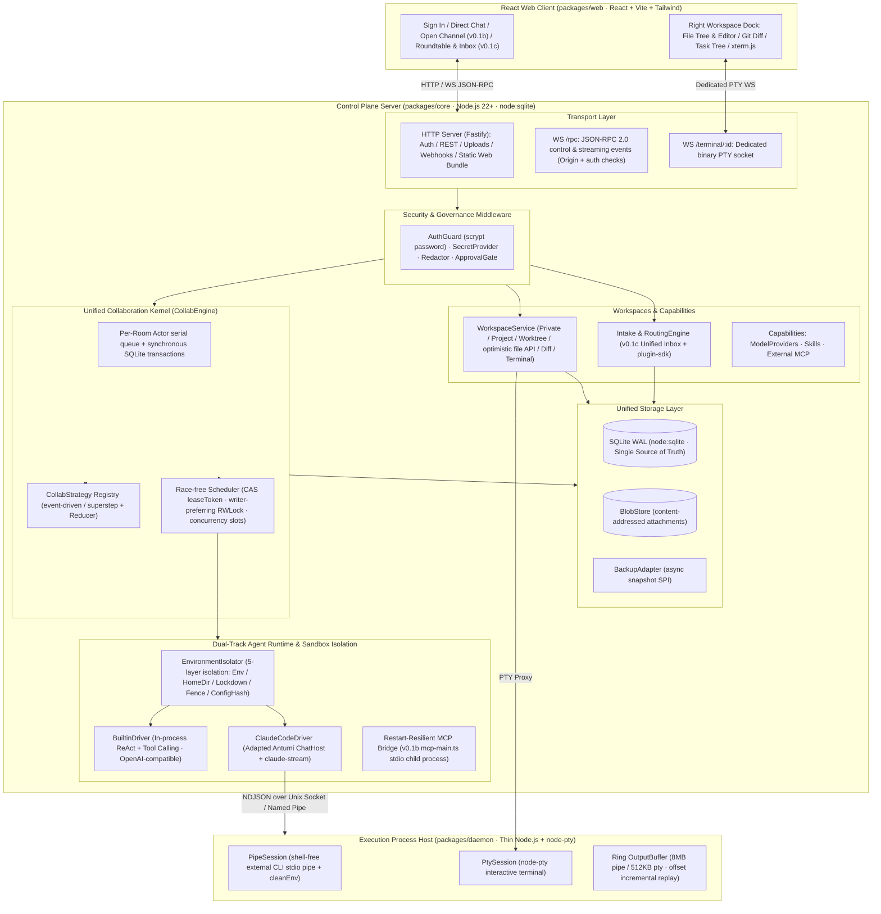
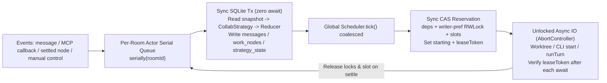

# 02. System Architecture Design

> **Status**: v2.0 Final (incorporates review refactors, race-free scheduler, 5-layer agent isolation, Reducer + Super-step dual-beat engine, and Antumi backend adaptation boundaries)  
> **Deployment Boundary**: `v0.x` targets a **single Core instance** server-first architecture (in-memory Per-Room Actor, writer-preferring RW lock, local workspaces, local Daemon socket). Future multi-node scaling upgrades Core-to-Daemon NDJSON over TLS/WS.

---

## 1. Layered System Architecture



---

## 2. Monorepo Structure & Reuse Boundaries

### 2.1 Package Boundaries & Dependency Graph
```text
my-agents/
├── pnpm-workspace.yaml
├── tsconfig.base.json
├── docs/                          # Architecture & milestone specs
└── packages/
    ├── protocol/                  # Zero IO/business logic, Zod-only browser-safe + node subpath
    │   └── src/
    │       ├── models/            # Agent / Workspace / Room / WorkNode / File / Auth schemas
    │       ├── state-machines/    # Pure state transition validators shared by core & web
    │       ├── rpc/               # WS JSON-RPC method & event schemas
    │       ├── collab/            # CollabStrategy / Reducer / EngineAction / MCP constants
    │       ├── isolation/         # IsolationProfile & permission mapping contracts
    │       ├── hooks/             # 4 security hook interfaces
    │       └── node/              # @myagents/protocol/node: daemon NDJSON, paths, planLaunch
    ├── daemon/                    # Thin process host, zero business logic, node-pty only
    ├── plugin-sdk/                # SourcePlugin SDK contracts
    ├── core/                      # Node.js control plane using native node:sqlite
    └── web/                       # React + Vite + Tailwind + Zustand + xterm.js SPA
```

**Strict Dependency Direction** (no cycles or reverse edges):
- `web` -> `protocol`
- `daemon` -> `protocol/node`
- `plugin-sdk` -> `protocol`
- `core` -> `protocol`, `protocol/node`, `plugin-sdk`

### 2.2 Antumi (Apache-2.0) Adaptation vs. Original Implementation
Source adapted from Antumi follows Apache-2.0 attribution requirements (see `THIRD-PARTY-NOTICES.md`):
- **Adapted Node.js Infrastructure**:
  - `packages/daemon/src/` (`session-host`, `pipe-session`, `pty-session`, `output-buffer`, `endpoint-claim`)
  - `packages/protocol/src/node/` (`command-launch.ts` shell-free Windows `.cmd`/`.ps1` launcher, `daemon-protocol.ts`, `paths.ts`, `private-file.ts`)
  - `packages/core/src/chat-host.ts` + `line-framer.ts` + `agents/claude/` (`claude-stream`, `claude-command`, `claude-provider`)
  - `packages/core/src/workspace.ts`, `worktree-service.ts`, `git-service.ts`, `terminal-service.ts`, `mcp-main.ts` (`v0.1b`)
  - `packages/core/src/agent-account-home.ts`, `reference-paths.ts` (5-layer isolation support)
- **Original Core & Web Platform**:
  - **Custom `packages/web` React SPA**
  - **In-process `BuiltinDriver`** (streaming ReAct + tool calling + `workspace_*` tools)
  - **Unified `CollabEngine` + Pluggable `CollabStrategy`** (Reducer + `event-driven` / `superstep` dual execution model)
  - **Race-free Scheduler** (writer-preferring RWLock + CAS `lease_token` + `work_deliveries`) and auth baseline

---

## 3. Agent Environment Isolation (5-Layer Defense-in-Depth)

> **Phased Delivery**: `v0.1a` implements `IsolationProfile` contracts, `daemon.spawnPipeClean`, and baseline env/tool scoping; `v0.1b` activates full config-dir isolation, strict `lockdown` enforcement, and `config_hash` drift restarts.

`core/src/runtime/environment-isolator.ts` compiles an orthogonal 5-layer `IsolatedLaunchPlan` for external CLI execution:

### Layer 1: Environment Sanitization & Provider Scrubbing (`Env Isolation`)
- **Minimal Allowlist (`CLEAN_ENV_KEYS`)**: `daemon` exposes `spawnPipeClean`, preserving only essential OS keys (`PATH`, `HOME`, `USER`, `LANG`, `TZ`, `TMPDIR`, Windows `SYSTEMROOT/WINDIR/PATHEXT/USERPROFILE/APPDATA`, proxy & CA cert vars) and stripping stray `*_API_KEY` / `*_TOKEN` values from the host shell.
- **Claude Provider Reset**: Explicit reset of interfering variables (`CLAUDE_CODE_USE_BEDROCK=''`, `CLAUDE_CODE_USE_VERTEX=''`, `CLAUDE_CODE_OAUTH_TOKEN=''`, `ANTHROPIC_MODEL=''`, `ANTHROPIC_CUSTOM_HEADERS=''`) plus `CLAUDE_CODE_PROVIDER_MANAGED_BY_HOST=1` so host `~/.claude/settings.json` cannot hijack provider routing.

### Layer 2: Config Directory Isolation (`Home / Config Dir Isolation`)
- Isolated config homes live under `~/.myagents/agent-homes/<profileKey>/` and are injected via `CLAUDE_CONFIG_DIR=<dir>` (and `CODEX_HOME` for Codex).
- When sharing history across profiles, only non-credential subdirectories (e.g., `projects/`) are linked via symlinks or Windows unprivileged junctions, leaving host `~/.claude/` untouched.

### Layer 3: Tool Permission Fence & Dual-Layer Subagent Blocking
- **Effective Permission Formula**:
  $$\text{EffectivePermission} = \min(\text{agent.permissionMode},\ \text{node.workspaceMode},\ \text{strategy.workspacePolicy},\ \text{sourceTrustLevel})$$
- **Claude Code CLI Flag Mapping**:

| Isolation Level | `permissionMode` x `workspaceMode` | Claude CLI Flags |
| :--- | :--- | :--- |
| **`lockdown` (untrusted external inputs)** | `read-only` + untrusted source | `--restricted --tools "" --strict-mcp-config --setting-sources "" --disable-slash-commands --no-chrome --allowedTools mcp__myagents__<readonly_tools>` |
| **`fenced-ro` (read-only analysis / roundtable)** | `read-only` | `--permission-mode plan` + `--disallowedTools Edit(//<dir>/**),Write(//<dir>/**),Agent,Task` + `--allowedTools Read,Glob,Grep,Bash(git log:*),Bash(git diff:*),Bash(git show:*)` |
| **`workspace-rw` (normal coding)** | `workspace-write` + `shared-rw/worktree` | `--permission-mode acceptEdits` + `--disallowedTools Edit(//<refDir>/**)`; multi-agent rooms always add `--disallowedTools Agent,Task` |
| **`full` (unattended full access)** | `full` + `shared-rw/worktree` | `--allow-dangerously-skip-permissions --permission-mode bypassPermissions` (explicit UI warning); multi-agent rooms still enforce `--disallowedTools Agent,Task` |

> **Windows Path Normalization**: Following `claudeRulePath`, absolute rule paths passed to `--allowedTools / --disallowedTools` convert `C:\foo\bar` to POSIX `//c/foo/bar`.  
> **Honest Boundary Note**: Builtin file APIs enforce containment via `resolveContainedPath`, whereas `workspace_exec`, Web PTY, and external CLIs in `full` mode execute under the server OS user unless the deployment runs inside a container or OS sandbox.

### Layer 4: Workspaces, Attachments & Read-Only References
- **Directory Roles**:
  - Primary workspace (`cwd`): Only mutable root (`agent_private` / `project` / `git_worktree` / `shared`).
  - Attachment staging (`~/.myagents/attachments/<roomId>/`): Never copied into user Git repos; exposed selectively via read-only `Read(//<file>)` rules.
  - Read-only reference paths (`readonlyRefPaths`): Mounted without `--add-dir` (preventing unwanted `.claude/skills` discovery), authorized solely for `Read` and explicitly denied `Edit`.
- **Immutable Skill Bundles**: Built under `~/.myagents/skills/bundles/<hash>/` for stable `--plugin-dir` mounting and prompt cache locality.

### Layer 5: Live Session Config Drift Detection (`config_hash`)
- SHA-256 hash over effective runtime inputs (`model`, `systemPrompt`, `isolationProfile`, `skillBundleHash`, `mcpConfigHash`) stored in `agent_sessions.config_hash`.
- On subsequent turns, hash mismatch triggers graceful teardown and transparent CLI relaunch preserving `native_session_id`.

---

## 4. Thin Daemon, Hot-Restart Reattachment & Restart-Resilient MCP Bridge

### 4.1 Startup Reconciliation (6-Step Gate)
Before accepting mutating RPCs or starting `Scheduler.tick()` (`system.hello` reports `reconciling: true`), `core` runs:
1. Connect to `daemon` (`0600` Unix Socket / Windows Named Pipe) and invoke `daemon.list()`.
2. Reconcile `terminal_sessions`: reattach live PTYs, mark missing ones `exited`.
3. Reconcile live external CLI `agent_sessions` via `ChatHost` (buffer new `data` with `attached = false` -> `daemon.attach(sessionId)` -> offset-ordered replay into `LineFramer(last_consumed_offset)` -> set `attached = true`). If `bufferStart > last_consumed_offset`, explicitly fail the active `WorkNode` with `failed(output_gap)` rather than corrupting framing.
4. Reconcile `work_nodes` with `status IN ('starting', 'running')`:
   - Reattached CLI still running -> restore in-memory locks & concurrency slot;
   - In-process `builtin` turn or missing child -> transition to `failed(core_restarted)`;
   - Interrupted `starting` setup -> clean partial artifacts and mark `failed(core_restarted)`.
5. Recover any `work_deliveries` in `status = 'pending'`.
6. Lift the `reconciling` gate and trigger `Scheduler.tick()`.

### 4.2 Restart-Resilient Builtin MCP Bridge (`v0.1b`, adapted from Antumi `mcp-main.ts`)
- `core` writes its ephemeral listen port and `internalToken` to `~/.myagents/run/core.json` (`0600`).
- External CLIs spawn a thin stdio child process (`node mcp-main.js --session <sessionId>`) which reads `core.json` per tool call, ensuring CLI MCP connections survive `core` restarts without HTTP 401 failures.

---

## 5. Dual-Track Runtime & Race-Free Collaboration Engine

### 5.1 Builtin Agent (`BuiltinDriver`)
- Runs inside `core` against `ModelProvider` endpoints with exact `AbortController` cancellation.
- Token deltas and tool events stream over WS while batched updates persist to `node_events`.
- Enforces `maxSteps` (default 25), per-tool timeouts, and bounded exponential backoff on HTTP 429/5xx solely inside the LLM client (no stacked queue retries).

### 5.2 Unified `CollabEngine`: Reducer + Dual Execution Beats

- **Pure State Reduction**: All strategy state transitions emit immutable `StateDelta` patches merged synchronously via `reduceState(prev, delta)` to prevent lost updates across concurrent nodes.
- **Dual Execution Models**:
  - **`event-driven`**: Used by `single` and `open-channel` for non-blocking concurrency and user steering at any point.
  - **`superstep`** (Pregel BSP inspired): Used by `roundtable` (`draft-review`, `split-research`). Nodes inside superstep `k` read only the frozen view from `k - 1` (blind isolation); once all nodes reach the barrier, a single transaction runs `reduceState`, advances `visible_seq`, and checkpoints the next step.

---

## 6. Storage Layout & Security Baseline

### 6.1 Directory Layout (`MYAGENTS_HOME=~/.myagents`)
```text
~/.myagents/
├── data/myagents.db            # SQLite WAL single source of truth (node:sqlite)
├── blobs/<aa>/<bb>/<sha256>    # Extensionless content-addressed blob storage
├── attachments/<roomId>/       # Read-only staged attachments for CLIs
├── workspaces/
│   ├── agents/<agentId>/       # Persistent per-agent private workspaces
│   └── rooms/<roomId>/         # Shared channel workspaces
├── worktrees/<shortId>/<repo>/ # 8-char short ID avoiding Windows MAX_PATH issues
├── agent-homes/<profileKey>/   # Isolated CLI config homes (CLAUDE_CONFIG_DIR)
├── skills/{repos,bundles}/     # Immutable skill bundle directories
└── run/{daemon.sock,core.json} # 0600 runtime IPC descriptors
```

### 6.2 Security Baseline
- `AuthGuard` ships with `SimplePasswordAuthGuard` (`admin / admin` default via `scryptSync` salted hashes) + persistent `auth_sessions` cookies + Bearer tokens + CSWSH `Origin` checks.
- Inbound `Webhook` routes enforce `X-Webhook-Secret` / HMAC signatures and run dispatched turns in `read-only` Lockdown mode by default.
- Remaining security hooks (`SecretProvider`, `Redactor`, `ApprovalGate`) maintain clean extension interfaces for pluggable policy enforcement.
