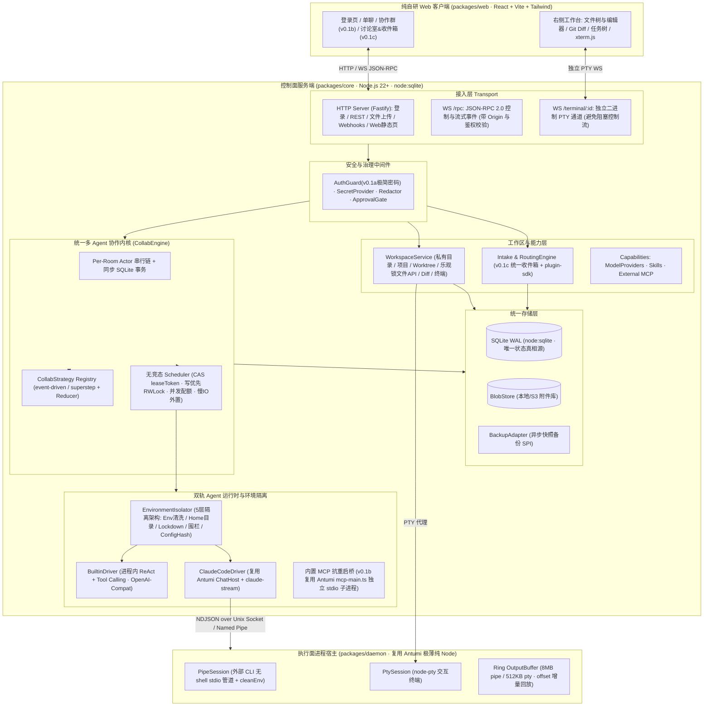
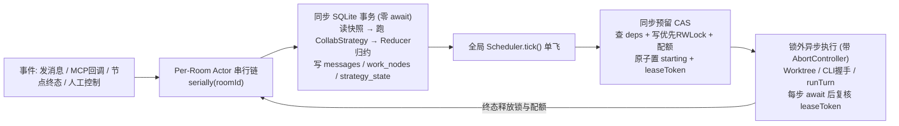

# 02. 系统架构设计文档（System Architecture）

> **文档状态**：v2.0 定稿（已合入评审重构、无竞态调度架构、5 层 Agent 环境隔离设计、Reducer + Super-step 双节拍引擎与 Antumi 后端复用策略）  
> **部署边界声明**：`v0.x` 为**单 Core 实例**纯服务端架构（内存级 Per-Room Actor、写优先读写锁、本地工作区与本地 Daemon Socket）；未来多节点执行通过将 `Core ↔ Daemon` 的 NDJSON 升级为 TLS/WS 横向扩展执行节点实现。

---

## 1. 总体分层架构



---

## 2. Monorepo 目录结构与复用策略

### 2.1 目录边界与依赖方向
```text
my-agents/
├── pnpm-workspace.yaml
├── tsconfig.base.json
├── docs/                          # 01~05 正式架构基线文档
└── packages/
    ├── protocol/                  # 【零业务/IO依赖，仅依赖 zod】
    │   └── src/
    │       ├── models/            # Agent / Workspace / Room / WorkNode / File / Auth 等 Schema
    │       ├── state-machines/    # 纯函数状态校验（前后端共享）
    │       ├── rpc/               # WS JSON-RPC 方法与事件 Schema
    │       ├── collab/            # CollabStrategy / Reducer / EngineAction / MCP 工具常量
    │       ├── isolation/         # IsolationProfile 与权限映射契约
    │       ├── hooks/             # 4 个安全 Hook 接口
    │       └── node/              # 子入口 @myagents/protocol/node：daemon NDJSON 协议、路径、Windows planLaunch
    ├── daemon/                    # 【极薄进程宿主，零业务逻辑，仅含 node-pty 原生依赖】
    ├── plugin-sdk/                # 【外部来源插件 SDK（v0.1c 激活）】
    ├── core/                      # 【纯 Node.js 控制面，使用原生 node:sqlite，零 C++ 编译依赖】
    └── web/                       # 【纯自研 React + Vite + Tailwind + Zustand + CodeMirror + xterm.js】
```

**强制依赖方向**（禁止逆向与循环依赖）：
- `web` ──► `protocol`
- `daemon` ──► `protocol/node`
- `plugin-sdk` ──► `protocol`
- `core` ──► `protocol`、`protocol/node`、`plugin-sdk`

### 2.2 Antumi（Apache 2.0）后端资产复用与自研边界
复用 Antumi 源码时遵守 Apache 2.0 许可（保留版权声明并标明修改）：
- **直接复用/适配的纯 Node 后端底座**：
  - `packages/daemon/src/`（`session-host`、`pipe-session`、`pty-session`、`output-buffer`、`endpoint-claim`；剔除 `awake-service`）
  - `packages/protocol/src/node/`（`command-launch.ts` Windows `.cmd` 无 shell 启动、`daemon-protocol.ts`、`paths.ts`、`private-file.ts`）
  - `packages/core/src/chat-host.ts` + `line-framer.ts` + `agents/claude/`（`claude-stream`、`claude-command`、`claude-provider`）
  - `packages/core/src/workspace.ts`、`worktree-service.ts`、`git-service.ts`、`terminal-service.ts`、`mcp-main.ts`（v0.1b）
  - `packages/core/src/agent-account-home.ts`、`reference-paths.ts`（用于 5 层环境隔离）
- **完全自研的核心差异化部分**：
  - **纯自研 `packages/web`**（不搬迁 Antumi 桌面端 renderer）
  - **内置轻量 `BuiltinDriver`**（进程内流式 ReAct + Tool Calling + `workspace_*` 工具）
  - **统一 `CollabEngine` + 可插拔 `CollabStrategy`（Reducer + `event-driven / superstep` 双节拍）**
  - **无竞态调度器**（写优先读写锁 + CAS `lease_token` + `work_deliveries`）与极简登录安全基线

---

## 3. Agent 环境隔离架构设计（5 层纵深隔离）

> **分期落地约定**：本节为完整架构与接口设计，**第一版（`v0.1a`）完成 `IsolationProfile` 契约、`daemon.spawnPipeClean` 能力及基础环境变量/工具禁用口子；第二版（`v0.1b`）全面激活目录隔离、Lockdown 模式与 `config_hash` 漂移检测**。

借鉴 Antumi 的实战隔离方案，将 Agent 执行隔离划分为 5 层正交机制，由 `core/src/runtime/environment-isolator.ts` 统一生成最终启动上下文（`IsolatedLaunchPlan`）：

### 层 1：环境变量清洗与覆盖（Env Isolation）
- **最小白名单（`CLEAN_ENV_KEYS`）**：`daemon` 提供 `spawnPipeClean` 原语，仅保留 OS 运行必需键（`PATH`, `HOME`, `USER`, `LANG`, `TZ`, `TMPDIR`, Windows `SYSTEMROOT/WINDIR/PATHEXT/USERPROFILE/APPDATA`, 代理与 CA 证书键），剥离宿主机可能泄漏的任意 `*_API_KEY` / `*_TOKEN`。
- **Claude Provider 环境变量归零**：当为 Claude Code 指定自定义模型服务商时，显式清空高优先级干扰变量（`CLAUDE_CODE_USE_BEDROCK=''`, `CLAUDE_CODE_USE_VERTEX=''`, `CLAUDE_CODE_OAUTH_TOKEN=''`, `ANTHROPIC_MODEL=''`, `ANTHROPIC_CUSTOM_HEADERS=''`），并设置 `CLAUDE_CODE_PROVIDER_MANAGED_BY_HOST=1`，防止宿主机 `~/.claude/settings.json` 劫持流量。

### 层 2：配置目录隔离（Home / Config Dir Isolation）
- 为每个需要隔离的 Agent（或外部账号配置）在 `~/.myagents/agent-homes/<profileKey>/` 建立独立配置目录，启动时注入 `CLAUDE_CONFIG_DIR=<dir>`（未来扩展 Codex 为 `CODEX_HOME`）。
- 若需跨账号共享历史会话，借鉴 Antumi `agent-account-home.ts` 的 `linkShared`：仅将非凭证子目录（如 `projects/`）通过符号链接（Windows 上使用免管理员权限的 `junction`）按需共享，凭证文件严格留在独立目录中，**绝不修改或污染宿主机用户的 `~/.claude/`**。

### 层 3：工具权限围栏与双层 Subagent 封堵（Tool & Subagent Fence）
- **最终生效权限公式**：
  $$\text{EffectivePermission} = \min(\text{agent.permissionMode},\ \text{node.workspaceMode},\ \text{strategy.workspacePolicy},\ \text{sourceTrustLevel})$$
- **Claude Code CLI 参数映射表**（由 `IsolationProfile` 编译生成）：

| 场景 / 隔离级别 | `permissionMode` × `workspaceMode` | Claude CLI 关键启动参数 |
| :--- | :--- | :--- |
| **极严锁死（`lockdown`，v0.1b/c 外部自动触发）** | `read-only` + 非信任来源 | `--restricted --tools "" --strict-mcp-config --setting-sources "" --disable-slash-commands --no-chrome --allowedTools mcp__myagents__<readonly_tools>` |
| **只读分析 / 圆桌讨论（`fenced-ro`）** | `read-only` | `--permission-mode plan`（或 `default` + 禁写）+ `--disallowedTools Edit(//<dir>/**),Write(//<dir>/**),Agent,Task` + `--allowedTools Read,Glob,Grep,Bash(git log:*),Bash(git diff:*),Bash(git show:*)` |
| **工作区读写（`workspace-rw`）** | `workspace-write` + `shared-rw/worktree` | `--permission-mode acceptEdits`（v0.1 无弹窗模式下自动放行工作区编辑）+ 对只读参考目录加 `--disallowedTools Edit(//<refDir>/**)`；多 Agent 房间必加 `--disallowedTools Agent,Task` |
| **全权执行（`full`）** | `full` + `shared-rw/worktree` | `--allow-dangerously-skip-permissions --permission-mode bypassPermissions`（Web 配置页显式标红风险提示）；多 Agent 房间仍必加 `--disallowedTools Agent,Task` |

> **Windows 路径规则**：借鉴 Antumi `claudeRulePath`，写入 `--allowedTools / --disallowedTools` 的绝对路径必须将 `C:\foo\bar` 转为 POSIX 形式 `//c/foo/bar`。  
> **安全边界诚实声明**：v0.1 阶段自有文件 API 通过 `resolveContainedPath` 防止越界误操作；但 `workspace_exec`、Web PTY 与开启 `full` 模式的外部 CLI 仍运行在当前 OS 用户权限下，真正强沙箱隔离依赖 Docker 容器或 OS 沙箱运行整套服务端。

### 层 4：工作区、附件与只读参考目录隔离
- **独立目录角色**：
  - 主工作区（`cwd`）：Agent 唯一可自由活动的根目录（`agent_private` / `project` / `git_worktree` / `shared`）。
  - 附件映射目录（`~/.myagents/attachments/<roomId>/`）：**绝不拷进用户 Git 代码仓库**，只通过只读规则 `Read(//<file>)` 精确授权单文件读取。
  - 只读参考目录 / 知识库（`readonlyRefPaths`）：不传 `--add-dir`（避免 Claude 连带加载其中的 `.claude/skills`），仅授权 `Read(//<refDir>/**)` 且加 `Edit(//<refDir>/**)` 拒绝规则。
- **Skill 注入**：按配置哈希生成不可变只读目录 `~/.myagents/skills/bundles/<hash>/`，Claude 通过 `--plugin-dir` 挂载（利于 Prompt Cache 保温）。

### 层 5：热会话配置漂移检测（`config_hash`）
- 每次启动外部 CLI 会话时，将影响行为的配置（`model`、`systemPrompt`、`isolationProfile`、`skillBundleHash`、`mcpConfigHash`）计算 SHA-256 存入 `agent_sessions.config_hash`。
- 下一回合开始前若发现当前配置哈希与存活进程不一致，自动优雅结束旧进程并按新配置无感重启续接（保留 `native_session_id`），彻底杜绝“改了人设/权限但热进程不生效”。

---

## 4. 极薄 Daemon、热重启接管与抗重启 MCP 桥

### 4.1 进程隔离与启动对账（Reconcile）
`core` 启动时在放开写接口和启动调度器之前，必须完成严格 6 步对账（期间 `system.hello` 返回 `reconciling: true`）：
1. 连接 `daemon`（Unix Socket `0600` / Windows Named Pipe），执行 `daemon.list()`。
2. 对账 `terminal_sessions`：存活终端保持可附着，已消失终端标记 `exited`。
3. 对账存活的外部 CLI `agent_sessions`：通过 `ChatHost`（先置 `attached = false` 暂存新 `data` → 调用 `daemon.attach(sessionId)` 拉回缓冲 → 按 `offset` 排序去重喂给 `LineFramer(last_consumed_offset)` → 置 `attached = true`）。若 `bufferStart > last_consumed_offset`（缓冲溢出缺口），显式标当前 `WorkNode` 为 `failed(output_gap)`，不静默错位。
4. 对账所有 `status IN ('starting', 'running')` 的 `work_nodes`：
   - 外部 CLI 成功接管且回合未结束 → 重建内存锁与活跃配额占用继续监听；
   - `builtin` 进程内任务或进程已丢失 → 标 `failed(core_restarted)`；
   - 卡在 `starting`（如建 Worktree 中断）→ 清理半成品并回退 `failed(core_restarted)`。
5. 扫描恢复所有 `status = 'pending'` 的 `work_deliveries`（两阶段投递防漏唤醒）。
6. 解除 `reconciling` 门禁，启动 `Scheduler.tick()`。

### 4.2 抗重启内置 MCP 桥（v0.1b 落地，复用 Antumi `mcp-main.ts`）
- `core` 启动时将监听端口与随机 `internalToken` 写入 `~/.myagents/run/core.json`（权限 `0600`）。
- 外部 CLI 不直接连易变的 HTTP URL query token，而是启动独立轻量 stdio MCP 子进程（`node mcp-main.js --session <sessionId>`）；该子进程每次收到工具调用时从 `core.json` 读取最新地址与 Token 转发给 `core`，**即使 `core` 中途重启，外部 CLI 的 MCP 连接也不断裂、不报 401**。

---

## 5. 双轨 Agent 运行时与无竞态协作引擎

### 5.1 内置轻量 Agent（`BuiltinDriver`，v0.1a 核心自研）
- 跑在 `core` 进程内，直连 `ModelProvider`（OpenAI Chat Completions / Responses / Anthropic 兼容格式），使用 `AbortController` 精准取消。
- 流式 Token 与工具调用经 `emit()` 实时推给 Web 端（内存节流合并，绝不逐 Token 写 SQLite），每步工具完成后批量落库 `node_events`。
- 内置 `maxSteps`（默认 25）、单步工具超时与网络 429/5xx 指数退避重试（**网络重试仅存在于 LLM Client 这一层，严禁外层队列叠加重试**）。

### 5.2 统一 `CollabEngine`：Reducer + 双节拍调度

- **全局标配 Reducer 归约**：所有策略状态变更均通过不可变 `StateDelta` 经纯函数 `reduceState(prev, delta)` 在同步事务内合并，杜绝并发节点后写覆盖先写。
- **双节拍原生支持**：
  - **`event-driven`**：适合 `single` 单聊与 `open-channel` 开放协作群，无全局阻塞，支持异步自由并发与人类随时插话。
  - **`superstep`**（借鉴 LangGraph Pregel BSP）：适合 `roundtable` 圆桌、`draft-review` 评审、`split-research` 调研；每个超步内成员只读上一超步冻结视图（天然盲答隔离），全员到达屏障后由 Reducer 一次性归约状态、推进 `visible_seq` 并落盘检查点。

---

## 6. 存储、备份与最低安全基线

### 6.1 目录结构（`MYAGENTS_HOME=~/.myagents`）
```text
~/.myagents/
├── data/myagents.db           # SQLite WAL 唯一状态真相源 (node:sqlite)
├── blobs/<aa>/<bb>/<sha256>   # 无扩展名内容寻址去重附件库
├── attachments/<roomId>/      # 按需映射给外部 CLI 只读的临时硬链/副本（不污染 Git 仓）
├── workspaces/
│   ├── agents/<agentId>/      # Agent 私有持久工作区
│   └── rooms/<roomId>/        # 群聊共享工作区
├── worktrees/<shortId>/<repo>/# 8位短ID防 Windows 260字符路径超限
├── agent-homes/<profileKey>/  # 隔离配置目录（CLAUDE_CONFIG_DIR 等，v0.1b）
├── skills/{repos,bundles}/    # Skill 仓库与内容哈希不可变 bundle
└── run/{daemon.sock,core.json}# 0600 权限运行时端点文件
```

### 6.2 最低安全基线（v0.1a 落地，约 150 行）
- `AuthGuard` 默认注入 **`SimplePasswordAuthGuard`**：`admin / admin`（`scryptSync` 加盐哈希，可改密）+ `auth_sessions` 持久化 Cookie + Bearer Token + WS 握手同源 `Origin` 校验。
- `Webhook`（v0.1c）强制校验 `X-Webhook-Secret` / HMAC，自动路由节点默认 `read-only` 降权。
- 其余 3 个安全 Hook（`SecretProvider`、`Redactor`、`ApprovalGate`）在 v0.1a 保持清晰接口与轻量/Noop 实现，后续零侵入替换。
