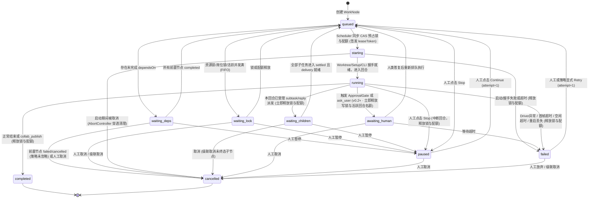

# 03. 领域模型与核心状态机设计（Domain Design）

> **文档状态**：v2.0 定稿（已修复评审指出的调度死锁、身份串台、双真相源、Reveal 漏读、中文正则及圆桌逻辑漏洞，并融合 Reducer + 双节拍 Super-step 与禁止私开 Subagent 约束）

---

## 1. 限界上下文与一等身份体系

系统分为 6 个限界上下文：**Collaboration（协作核心）**、**Agent & Runtime（智能体与运行时）**、**Workspace（工作区）**、**Intake（接入与路由）**、**Capability（平台能力）**、**Storage（存储与附件）**。

### 关键身份修正：`room_member_id` 为协作层一等身份
为了支持“同一个 Agent 以不同立场（如正方/反方）加入同一个 Room”且绝不串台：
- **配置层身份**：`agent_id`（用于并发配额统计 `maxConcurrency`、模型/驱动配置、私有工作区归属）。
- **协作层身份**：`room_member_id`（每个 Room 内的一个固定席位）。
  - `agent_sessions` 按 `(room_id, room_member_id)` **严格 1 对 1 唯一绑定**；
  - `work_nodes` 记录 `assignee_member_id`（主归属）和 `assignee_agent_id`（用于并发统计）；
  - `room_messages` 的可见性 `visible_to_member_ids` 按 `room_member_id` 判定。
- **单席位严格串行原则**：同一个 `(room_id, room_member_id)` 同一时刻最多只运行 **1 个活跃回合**（隐式持有独占锁 `member:<roomMemberId>`）。不派生并行临时子会话，彻底消除会话合并冲突；需要同模型并行时，在 Room 中配置两个独立席位或跨 Room 并行。
- **固定编组、禁止私开 Subagent**：Room 成员在配置中固定，任何 Agent 不得在协作中私自派生未在编的临时 Agent 或开启 CLI 原生 Subagent。

---

## 2. 核心聚合与不变量（Invariants）

### 2.1 `Agent`
- 每个 `Agent` 必有一个 `agent_private` 私有工作区。
- 并发上限分离为两个概念：
  - `maxRunningTurns`（活跃推理并发上限，默认 `builtin = 5`，`claude = 2`）；
  - 全局 `maxLiveProcesses`（宿主机存活外部 CLI 进程总数上限，默认 `12`，超限时 LRU 休眠最久未活跃的空闲进程）。

### 2.2 `Workspace`
- `kind ∈ {'agent_private', 'project', 'git_worktree', 'shared'}`。
- 所有平台文件读写必须通过 `resolveContainedPath(rootPath, relPath)` 校验 `realpath` 包含关系；文件写操作支持 `expectedMtime` 乐观锁防止静默覆盖。
- `git_worktree` 清理前必须满足：无关联活跃 `WorkNode`、无未提交改动（除非人工强制）；清理只删目录，永不删 Git 分支与提交；Windows 下采用 8 位 `shortId` 目录名缓解 260 字符路径限制。

### 2.3 `Room` & `RoomMessage`
- `Room.state` 与 `archived_at` 职责分离：`state ∈ {'active', 'running', 'pausing', 'paused', 'done'}` 表达运行态，`archived_at` 独立表达是否归档（恢复归档时原样保留 `done` 或 `active` 状态）。
- **唯一 `visible_seq` 机制（彻底解决 Reveal 增量漏读）**：
  - `room_messages` 同时持有 `seq`（写入序号）和 `visible_seq`（对全员公开的序号）。
  - `public` 消息写入时 `visible_seq = seq`；
  - `private` 盲答消息写入时 `visible_seq = 0`（仅 `visible_to_member_ids` 可见）；
  - 执行 `reveal_messages` 时，为 Room 分配新的 `last_seq` 写入该批消息的 `visible_seq`。
  - 任意热会话拉取未读增量消息只需一条 SQL：
    `(visibility_scope = 'public' AND visible_seq > last_delivered_seq) OR (visibility_scope = 'private' AND visible_to 含本席位 AND seq > last_delivered_seq)`。

### 2.4 `WorkNode`、`WorkNodeDep` 与 `WorkDelivery`（调度单一真相源）
- **`work_nodes` 表本身就是节点调度的唯一真相源**（彻底移除 `job_queue` 对 `WorkNode` 的镜像管理）。
- 依赖关系存放在独立表 `work_node_deps(node_id, depends_on_id)`，创建时执行 DFS 环检测；任意节点终态时可 O(1) 反查下游节点。
- 父子结果回传通过 `work_deliveries(id, room_id, target_node_id, child_node_ids_json, payload_text, status: 'pending' | 'sent')` 实现两阶段幂等投递，崩溃重启绝不重复唤醒、绝不漏结果。

---

## 3. 修订后的核心状态机

### 3.1 `WorkNode` 状态机（无死锁、完整边界）

#### 关键语义边界（强约定）
1. **终态集合**：`settled = { completed, failed, cancelled }`。父节点判断子节点全部收口统一检查 `allChildrenIn(settled)`。
2. **持锁期 vs 让出期（根治父子死锁）**：
   - **仅 `starting` 和 `running` 持有资源锁、席位锁与活跃推理配额**；
   - 进入 `waiting_children`、`paused`、`awaiting_human` 或任何 `settled` 终态时，**必须立即释放所有资源写锁、席位锁与活跃推理配额**。
3. **工具调用冲突规则**：
   - 同一回合若已发出至少 1 个未结束的 `subtask` 或 `collab_reply`，调用 `collab_publish` 直接拒绝（提示等待子任务或先取消）；
   - 成功调用 `collab_publish` 后，该回合后续残余输出折叠进过程日志，不重复发公开消息；
   - 回合结束未调用 `collab_publish`：普通模式取最终文本，圆桌模式默认补 `verdict = 'changed'` 并记一条告警事件；
   - 是否转入 `waiting_children` **完全以 `CollabEngine` 实际受理的子任务表为准**，不信任 Driver 返回的布尔标志。
4. **`transfer` 与 `reassign` 语义**：
   - `collab_dispatch(mode: 'transfer')`：原节点立即置为 `completed`（记 `transferred_to_node_id`），新节点继承同一 `request_msg_id` 独立执行；
   - 人工 `reassign`：永不原地改 `assignee_member_id`，固定执行 `cancel(oldNode)` + `spawn(newNode, supersedes_node_id = oldNode.id)`，保证会话干净与审计完整。
5. **迟到结果约定**：父节点已 `completed` 后，若人类手动对某个先前失败的子节点点 `retry` 并完成，不改写已终结父节点，内核自动在 Room 贴一条 `system_notice` 通知，由策略或人类决定是否新开汇总。

### 3.2 `AgentSession` 生命周期状态机
`cold` ──▶ `starting` ──▶ `ready` ⇄ `busy`  
`ready` ──(空闲 30m / 超 `maxLiveProcesses` LRU)──▶ `hibernated`（保留 `native_session_id`）  
`busy` ──(`core` 重启期间 `daemon` 存活)──▶ `detached` ──(`reconcile` `attach` 回放)──▶ `busy`  
`starting / busy` ──(进程异常退出 / 缓冲溢出 `output_gap`)──▶ `crashed`（下次发消息按历史移交重建）

---

## 4. 无竞态调度器架构与核心算法

### 4.1 两级串行化 + 慢 I/O 外置
1. **Per-Room Actor（`serially(roomId)`）**：同一 Room 的所有状态推进（发消息、MCP 回调、节点终态、人工控制）串行排队；利用 `node:sqlite` 同步特性，将「读快照 → 跑策略 → Reducer 归约 → 校验护栏/环检测 → 落库」包进**单个零 `await` 同步事务**。
2. **全局 `Scheduler.tick()`（`setImmediate` 单飞合并）**：
   - 同步扫描 `status = 'queued'` 节点（按 `created_at ASC` FIFO），校验依赖全完成、资源读写锁与席位锁无冲突、活跃推理配额有余量 → **单事务 CAS 置 `starting`、签发新 UUID `lease_token`、内存预占锁与配额**。
   - 慢操作（Worktree 创建、`setup`、CLI 启动、LLM 回合）全部放锁外异步执行，绑定 `AbortController` 登记在 `inFlight` Map。
   - 取消穿透：用户点 `Cancel / Stop` 立刻改 DB 状态并 `abort()`；慢操作每步 `await` 完成后复核 DB 中 `status === 'starting' && lease_token === myToken`，不匹配则立即销毁半成品安静退出。

### 4.2 写优先读写锁（Writer-Preferring RWLock）
每个节点的锁资源集合自动推导：
- 必含席位独占锁：`member:<assignee_member_id>`（写锁）；
- 若 `workspace_mode === 'read-only'`：对目标工作区路径申请 **共享读锁** `ws_read:<absPath>`（同目录多个只读节点完全并发）；
- 若 `workspace_mode === 'shared-rw'`：对主工作区申请 **独占写锁** `ws_write:<absPath>`（与同目录及其祖先/子目录所有读/写锁互斥）；
- 若 `workspace_mode === 'worktree'`：仅对**独立 Worktree 路径**申请独占写锁 `ws_write:<worktreePath>`（不阻塞主仓库及其他 Worktree，天然并行！）；
- 显式 `resources[]`（如 `browser`）申请独占写锁。
- **防写饥饿**：若等待队列队首存在 `ws_write:<dir>` 等待某目录，后续新到的重叠目录 `ws_read` 必须排在其后，防止写任务被持续只读请求饿死。
- **Git 仓库锁分离**：`git worktree add/remove` 仅短时申请内存 `RepoMutex(git_common_dir)`，不阻塞其他 Worktree 内的 Agent 编码。

### 4.3 Reducer + 双节拍 `CollabStrategy` 模型
所有协作策略显式声明自己的执行节拍与状态归约器：
- **`executionModel: 'event-driven'`**（`single`、`open-channel`）：任意节点终态立即触发 `onNodeSettled` 与 `reduceState`，无全局屏障阻塞。
- **`executionModel: 'superstep'`**（`roundtable`、`draft-review`、`split-research`）：
  - 每个超步 `k` 派发的一批节点携带相同的 `superstep = k`，上下文读取严格冻结在 `k - 1` 提交的快照（天然实现盲答隔离）；
  - 只有当本超步全部节点到达 `settled`（Barrier），内核才在单个同步事务中：依次对本超步所有产出执行 `reduceState` → 执行 `reveal_messages`（推进 `visible_seq`）→ 触发 `onSuperstepBarrier` 决定进入 `k + 1` 或进入总结/结束。

### 4.4 修正后的协作群（`open-channel`，v0.1b）路由规则
1. 开头显式 `@everyone` → 全部活跃席位各建 Root 节点。
2. 开头显式 `@席位名1 @席位名2`（最长前缀匹配、忽略大小写）→ 为命中席位各建 Root 节点。
3. 显式 Reply 某条消息 → 若该消息对应活跃节点且目标 Driver 支持 `steer` 则插话，否则排队至下一回合；若对应已完成消息则派给原席位。
4. 续跑指令（修正中文正则）：整句匹配 `/^(?:continue|resume)(?:$|[\s.!])|^(?:继续|接着做|接着来)(?:$|[\s，。！!,.])$/i` 且存在最近 `paused` Root 节点 → 恢复之。
5. 群内仅 1 名活跃席位 → 直接派给它。
6. 兜底 Lead 无工具轻量路由 → 输出 `{ action: 'assign', memberNames[] } | { action: 'continue', nodeId } | { action: 'idle' }`（不再强制覆盖正文提及成员名的 `idle`，改为给 Lead 路由提示词弱提示）；解析失败兜底交给 Lead 本人。

### 4.5 修正后的圆桌策略（`roundtable`，v0.1c，Super-step 模式）
1. **区分开题与中途插话**：讨论进行中（`running / pausing`）人类发消息不重置 `round = 1`，而是直接入消息流，供下一个 Super-step 全体成员读取；仅 `done` 后显式发起新议题才开新周期。
2. **盲答防 Chair 偷看**：第 1 超步所有参与作答的成员（含 Chair 若参与作答）产出消息的 `visible_to_member_ids` **仅包含自己**（`[memberId]`），所有人到达 Barrier 后统一 Reveal 为 `public`，Chair 绝不提前偷看先交卷成员的观点。
3. **匿名脱敏**：开启 `anonymous` 时，所有上下文中的成员名、队友前缀、工作区显示名统一替换为 `成员 A / B / C`（按 `room_members.position` 稳定映射）。
4. **单成员失败处理**：本超步若全部失败 → Room 置 `paused`；若部分失败 → 默认暂停等待人类点击重试失败席位或点“忽略失败继续下一轮”。

### 4.6 上下文投递：全量包 vs 增量包
- **全量包**（用于 `builtin`、冷启动 `cold`、崩溃重建 `crashed` 或无法原生续接的会话）：按 **估算 Token 预算**（如 `16k / 32k` Token，预留 MCP 工具与 Skill 固定配额）拼装：身份与权限边界 + 共享记忆 + 滚动摘要 + 可见历史消息（过滤 `visibility`，折叠过程碎碎念，渲染每条消息短 ID `#m12` 与成员名便于工具引用）+ 当前任务与 `stoppedTasks`。
- **增量包**（用于热态外部 CLI 会话）：只按 `visible_seq > last_delivered_seq`（含本人私密消息 `seq > last_delivered_seq`）拉取新增消息与当前任务指令，避免重复注入历史浪费 Token。

### 4.7 防死循环与成本护栏表

| 护栏项 | 默认值 | 行为 |
| :--- | :--- | :--- |
| 单 Root 自动 `collab_dispatch` 上限 | `8` 次 | 拒绝新派发，提示直接汇总 |
| 单 Root 成员间 `collab_reply` 上限 | `2` 次 | 拒绝追问 |
| 节点最大嵌套深度 | `3` 层 | 拒绝更深派发 |
| 内置 Agent 单回合 `maxSteps` | `25` 步 | 终止工具循环，要求最后无工具总结 |
| 外部 CLI 首帧超时 / 空闲超时 | `60s` / `300s` | 中断回合，标 `failed(timeout)` |
| 单 Root 总耗时上限（可配） | `30m` | 标记告警或暂停 |
| LLM 网络重试（仅 429/5xx） | 仅在 LLM Client 内 `3` 次 | 绝不在调度队列层叠加重试 |
| 幂等键 | `rooms.sendMessage` 必填 `idempotencyKey`；工具调用用 `toolCallId` | 命中直接返回已建记录 |
