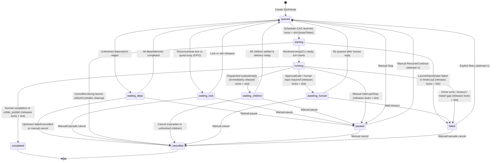

# 03. Domain Model & Core State Machine Design

> **Status**: v2.0 Final (resolves parent-child lock deadlocks, member identity conflation, dual queue truth sources, reveal sequence gaps, and incorporates Reducer + Super-step + Subagent restrictions)

---

## 1. Bounded Contexts & First-Class Identity

MyAgents separates concerns into 6 bounded contexts: **Collaboration**, **Agent & Runtime**, **Workspace**, **Intake & Routing**, **Capabilities**, and **Storage**.

### First-Class Collaboration Identity: `room_member_id`
To allow the same `Agent` to hold multiple seats (e.g., distinct pro/con reviewers) in one room without session collision:
- **Configured Identity (`agent_id`)**: Owns driver config, concurrency quota (`maxConcurrency`), and private workspace.
- **Seat Identity (`room_member_id`)**: Fixed membership seat inside a room.
  - `agent_sessions` binds strictly 1:1 on `(room_id, room_member_id)`.
  - `work_nodes` tracks `assignee_member_id` (seat ownership) and `assignee_agent_id` (quota accounting).
  - `room_messages` visibility (`visible_to_member_ids`) targets `room_member_id`.
- **Single-Seat Serialization**: At most **1 active turn** runs per `(room_id, room_member_id)` at any time (`member:<roomMemberId>` exclusive lock), eliminating branch/merge hazards inside a single CLI transcript.
- **Fixed Rosters & No Ad-Hoc Subagents**: Room seats are fixed at configuration time; native CLI `Agent`/`Task` subagent spawning is disabled at both orchestration and CLI layers.

---

## 2. Core Aggregates & Invariants

### 2.1 `Agent`
- Every agent automatically owns an `agent_private` persistent workspace.
- Concurrency controls separate two limits:
  - `maxRunningTurns` (active inference cap, default `builtin = 5`, `claude = 2`);
  - Global `maxLiveProcesses` (resident external CLI cap, default `12`, evicting LRU idle processes when full).

### 2.2 `Workspace`
- `kind` is one of `'agent_private' | 'project' | 'git_worktree' | 'shared'`.
- All platform file I/O validates containment via `resolveContainedPath(rootPath, relPath)` using realpath checks; writes accept `expectedMtime` for optimistic concurrency.
- Cleaning a `git_worktree` requires zero active dependent `WorkNode` entries and clean working tree unless `force: true`; removal deletes only the directory (never Git branches/commits), and Windows paths use 8-char `shortId` prefixes to avoid `MAX_PATH` limits.

### 2.3 `Room` & `RoomMessage`
- `Room.state` (`'active' | 'running' | 'pausing' | 'paused' | 'done'`) is independent of `archived_at`.
- **`visible_seq` Monotonic Visibility Mechanism**:
  - `room_messages` carries both `seq` (insert order) and `visible_seq` (public reveal order).
  - `public` messages receive `visible_seq = seq` immediately on insert.
  - `private` blind messages start with `visible_seq = 0` (readable only by `visible_to_member_ids`).
  - Executing `reveal_messages` assigns new monotonically increasing `visible_seq` values so warm sessions never miss revealed blind turns.
  - Incremental delivery query:
    `(visibility_scope = 'public' AND visible_seq > last_delivered_seq) OR (visibility_scope = 'private' AND visible_to_member_ids CONTAINS seat AND seq > last_delivered_seq)`.

### 2.4 `WorkNode`, `WorkNodeDep` & `WorkDelivery` (Single Source of Truth)
- **`work_nodes` itself is the authoritative scheduling queue** (no mirrored `job_queue` state).
- DAG edges live in `work_node_deps(node_id, depends_on_id)` with DFS cycle detection at insert time and O(1) reverse lookup on completion.
- Child-to-parent aggregation uses two-phase `work_deliveries(id, room_id, target_node_id, child_node_ids_json, payload_text, status: 'pending' | 'sent')` to guarantee crash-safe wakeup without duplicate delivery.

---

## 3. Core State Machines

### 3.1 `WorkNode` State Machine (Deadlock-Free)

#### Critical Semantic Invariants
1. **Settled States**: `settled = { completed, failed, cancelled }`. Parent readiness checks `allChildrenIn(settled)`.
2. **Lock Acquisition vs. Yielding (Zero Parent-Child Deadlock)**:
   - **Only `starting` and `running` hold resource locks, seat locks, and concurrency slots.**
   - Transitioning to `waiting_children`, `paused`, `awaiting_human`, or any `settled` state **immediately releases all locks and slots**.
3. **Tool Invocation Mutual Exclusion**:
   - Calling `collab_publish` while open `subtask` or `collab_reply` children exist is rejected.
   - After a successful `collab_publish`, trailing model chatter stays in trace events rather than duplicating public room messages.
   - Transition to `waiting_children` is decided exclusively by `CollabEngine` based on accepted child nodes.
4. **`transfer` vs. `reassign`**:
   - `collab_dispatch(mode: 'transfer')` marks the source node `completed` (`transferred_to_node_id`) and spawns an independent target node on the same `request_msg_id`.
   - Manual `reassign` never mutates `assignee_member_id` in place; it cancels the old node and creates a fresh successor node (`supersedes_node_id = oldNode.id`) for clean transcript & audit lineage.
5. **Late Child Retry**: Retrying a previously failed child after the parent already settled posts a `system_notice` rather than mutating the closed parent node.

### 3.2 `AgentSession` Lifecycle
`cold` -> `starting` -> `ready` <-> `busy`  
`ready` --(30m idle or `maxLiveProcesses` LRU eviction)--> `hibernated` (preserves `native_session_id`)  
`busy` --(`core` restart while `daemon` lives)--> `detached` --(reconcile `attach` replay)--> `busy`  
`starting / busy` --(unexpected exit or `output_gap`)--> `crashed` (next turn rebuilds with full context handoff)

---

## 4. Race-Free Scheduler & Algorithms

### 4.1 Two-Level Serialization + Lock-Free Slow I/O
1. **Per-Room Actor (`serially(roomId)`)**: Serializes all room transitions (inbound messages, MCP callbacks, settled nodes, manual controls) inside zero-`await` synchronous `node:sqlite` transactions.
2. **Global `Scheduler.tick()` (`setImmediate` Coalesced)**:
   - Scans `status = 'queued'` FIFO (`created_at ASC`), verifies dependencies, RWLocks, seat lock, and concurrency quota, then atomically marks `starting` with a fresh UUID `lease_token` inside one transaction.
   - Slow async work (worktree creation, setup, CLI spawn, LLM streaming) executes outside locks under an `AbortController` registered in `inFlight`.
   - Cancellation checks `status === 'starting' && lease_token === myToken` after every `await` and aborts cleanly on mismatch.

### 4.2 Writer-Preferring RWLock
Derived per node:
- Exclusive seat lock: `member:<assignee_member_id>`.
- `workspace_mode === 'read-only'`: Shared read lock `ws_read:<absPath>` (concurrent reads in the same workspace).
- `workspace_mode === 'shared-rw'`: Exclusive write lock `ws_write:<absPath>` (mutually exclusive with overlapping ancestors/descendants).
- `workspace_mode === 'worktree'`: Exclusive write lock `ws_write:<worktreePath>` (isolated per worktree, enabling parallel coding across branches).
- Explicit resource locks (e.g., `browser`) acquire exclusive locks.
- **Writer Starvation Prevention**: If a queued `ws_write:<dir>` sits at the head of wait queue, newly arriving overlapping `ws_read` nodes queue behind it.
- **Git Repo Mutex**: `git worktree add/remove` holds only a brief in-memory `RepoMutex(git_common_dir)`.

### 4.3 Reducer + Dual-Beat `CollabStrategy`
- **`executionModel: 'event-driven'`** (`single`, `open-channel`): Calls `onNodeSettled` and `reduceState` immediately on each node completion without a barrier.
- **`executionModel: 'superstep'`** (`roundtable`, `draft-review`, `split-research`):
  - Dispatches batches tagged `superstep = k`, frozen to the committed `k - 1` view.
  - Once all nodes in step `k` settle (barrier reached), one atomic transaction runs `reduceState`, reveals `visible_seq`, and calls `onSuperstepBarrier` to advance to `k + 1` or summarize.

### 4.4 Open Channel (`open-channel`, `v0.1b`) Routing Rules
1. Leading `@everyone` -> creates root nodes for all active seats.
2. Leading `@Member1 @Member2` (longest case-insensitive prefix match) -> creates root nodes for matched seats.
3. Explicit message Reply -> steers active session if supported, queues next turn on the replied seat, or re-invokes completed message's author seat.
4. Resume command matching `/^(?:continue|resume)(?:$|[\s.!?,])$/i` when a `paused` root node exists -> resumes the latest paused root.
5. Single active seat in room -> routes directly to that seat.
6. Fallback Lead classifier (toolless LLM prompt) -> `{ action: 'assign', memberNames[] } | { action: 'continue', nodeId } | { action: 'idle' }`, defaulting to Lead on parse error.

### 4.5 Roundtable (`roundtable`, `v0.1c`, Super-step Mode)
1. **Live Interjection vs. New Topic**: User messages while `running / pausing` do not reset `round = 1`; they join the message stream for the next superstep. Starting a new topic happens only after `done`.
2. **Blind Answer Isolation**: Superstep 1 outputs keep `visible_to_member_ids = [selfMemberId]` (`visible_seq = 0`) until all participants hit the barrier, preventing Chair or peers from peeking early.
3. **Anonymous Peer Review**: When `anonymous` is enabled, member names and workspaces map deterministically by `room_members.position` to `Member A`, `Member B`, `Member C`, etc.
4. **Partial/Full Failure**: All failures -> `paused`; partial failures -> `paused` with per-seat `Retry` or user advance to next round.

### 4.6 Full Context Package vs. Incremental Package
- **Full Package** (`builtin`, `cold`, `crashed`, or non-resumable CLI): Bounded by token budget, combining persona & isolation rules, shared memory, rolling summary, visible history (with `#m<seq>` short IDs), current task, and `stoppedTasks`.
- **Incremental Package** (warm external CLI sessions): Queries only `visible_seq > last_delivered_seq` (plus own private messages `seq > last_delivered_seq`) to preserve prompt cache and minimize input tokens.

### 4.7 Cost & Loop Guardrails

| Guardrail | Default | Enforcement |
| :--- | :--- | :--- |
| Max `collab_dispatch` per root tree | `8` | Reject new dispatches, instruct summarization |
| Max `collab_reply` per root tree | `2` | Reject further back-and-forth queries |
| Max node nesting depth | `3` | Reject deeper delegation |
| Builtin agent `maxSteps` | `25` | Terminate tool loop and request final text summary |
| External CLI first-byte / idle timeout | `60s` / `300s` | Abort turn, mark `failed(timeout)` |
| Total root execution timeout (configurable) | `30m` | Flag warning / pause |
| LLM transient HTTP retry (429 / 5xx) | `3` attempts in client | Never stacked at scheduler queue level |
| Idempotency keys | `idempotencyKey` on `rooms.sendMessage`; `toolCallId` on MCP | Deduplicate on repeat calls |
