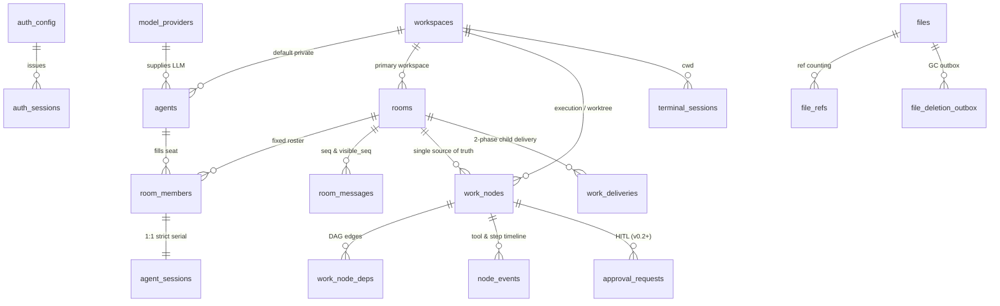

# 05. Database & Storage Design

> **Status**: v2.0 Final (uses Node 22+ native `node:sqlite`; establishes per-seat `agent_sessions`, `work_nodes` single scheduling source of truth, `work_node_deps`, `work_deliveries`, `node_events`, `terminal_sessions`, `visible_seq`, `file_refs`, and `auth_*`)

---

## 1. Storage Engine & Layers

- **Primary State Store**: Node 22+ built-in `node:sqlite` (`DatabaseSync`), zero C++ native SQLite dependencies, synchronous transactions pairing cleanly with Per-Room Actor serialization.
- **Initialization PRAGMAs**:
  ```sql
  PRAGMA journal_mode = WAL;
  PRAGMA synchronous = NORMAL;
  PRAGMA foreign_keys = ON;
  PRAGMA busy_timeout = 5000;
  PRAGMA temp_store = MEMORY;
  ```
- **Blob Store**: `~/.myagents/blobs/<aa>/<bb>/<sha256>` (extensionless content-addressed deduplicated storage), paired with `file_refs` reference counting and `file_deletion_outbox` for safe deletion.
- **Async Backups**: Low-traffic `VACUUM INTO` exports consistent SQLite snapshots delivered asynchronously via `BackupAdapter` (eventual consistency alongside blobs and workspaces).

---

## 2. Entity Relationship Overview



---

## 3. SQLite Schema DDL (22 Tables Activated Across Phases)

> Initial migration `0001_init.sql` provisions core trunk tables (1-15); subsequent migrations add inbox and ecosystem tables (16-22).

### 3.1 Metadata & Auth Baseline (`0001_init.sql` · `[v0.1a]`)

```sql
CREATE TABLE schema_migrations (
  version     INTEGER PRIMARY KEY,
  name        TEXT    NOT NULL,
  applied_at  INTEGER NOT NULL
);

-- Minimal auth account table (default admin / admin, scryptSync salted hash)
CREATE TABLE auth_config (
  id                  TEXT    PRIMARY KEY DEFAULT 'default',
  username            TEXT    NOT NULL UNIQUE,
  password_hash       TEXT    NOT NULL, -- "scrypt:<saltHex>:<hashHex>"
  is_default_password INTEGER NOT NULL DEFAULT 1 CHECK (is_default_password IN (0, 1)),
  updated_at          INTEGER NOT NULL
);

-- Persistent login sessions (survive core restarts)
CREATE TABLE auth_sessions (
  token_hash   TEXT    PRIMARY KEY,     -- SHA-256(sessionToken)
  username     TEXT    NOT NULL,
  expires_at   INTEGER NOT NULL,
  created_at   INTEGER NOT NULL,
  last_used_at INTEGER NOT NULL
);
CREATE INDEX idx_auth_sessions_expires ON auth_sessions(expires_at);
```

### 3.2 Providers, Workspaces, Agents & Terminals (`0001_init.sql` · `[v0.1a]`)

```sql
CREATE TABLE model_providers (
  id             TEXT    PRIMARY KEY,
  name           TEXT    NOT NULL UNIQUE,
  kind           TEXT    NOT NULL CHECK (kind IN ('openai-compat', 'anthropic', 'ollama', 'custom')),
  base_url       TEXT    NOT NULL,
  api_key_ref    TEXT,                  -- Resolved via SecretProvider
  default_model  TEXT    NOT NULL,
  models_json    TEXT    NOT NULL DEFAULT '[]',
  extra_json     TEXT    NOT NULL DEFAULT '{}', -- headers / timeoutMs / maxRetries
  created_at     INTEGER NOT NULL,
  updated_at     INTEGER NOT NULL
);

CREATE TABLE workspaces (
  id                  TEXT    PRIMARY KEY,
  kind                TEXT    NOT NULL CHECK (kind IN ('agent_private', 'project', 'git_worktree', 'shared')),
  name                TEXT    NOT NULL,
  root_path           TEXT    NOT NULL UNIQUE,
  is_git              INTEGER NOT NULL DEFAULT 0 CHECK (is_git IN (0, 1)),
  git_common_dir      TEXT,             -- Normalized Git common dir for RepoMutex
  git_branch          TEXT,
  base_commit         TEXT,
  parent_workspace_id TEXT    REFERENCES workspaces(id) ON DELETE SET NULL,
  owner_type          TEXT    NOT NULL CHECK (owner_type IN ('agent', 'room', 'work_node', 'global')),
  owner_id            TEXT,
  readonly_refs_json  TEXT    NOT NULL DEFAULT '[]',
  cleaned_at          INTEGER,
  created_at          INTEGER NOT NULL,
  updated_at          INTEGER NOT NULL
);
CREATE INDEX idx_workspaces_kind ON workspaces(kind);
CREATE INDEX idx_workspaces_owner ON workspaces(owner_type, owner_id);

CREATE TABLE agents (
  id                    TEXT    PRIMARY KEY,
  name                  TEXT    NOT NULL COLLATE NOCASE UNIQUE,
  bio                   TEXT    NOT NULL DEFAULT '',
  avatar_json           TEXT    NOT NULL DEFAULT '{}',
  system_prompt         TEXT    NOT NULL DEFAULT '',
  driver_kind           TEXT    NOT NULL CHECK (driver_kind IN ('builtin', 'claude', 'acp', 'codex', 'custom')),
  -- provider_id is the single source of truth for provider linkage
  provider_id           TEXT    REFERENCES model_providers(id) ON DELETE SET NULL,
  driver_config_json    TEXT    NOT NULL DEFAULT '{}', -- { model, temperature?, maxSteps?, cliPath?, effort?, dialect? }
  default_workspace_id  TEXT    NOT NULL REFERENCES workspaces(id),
  permission_mode       TEXT    NOT NULL DEFAULT 'workspace-write'
                        CHECK (permission_mode IN ('read-only', 'workspace-write', 'full')),
  isolation_mode        TEXT    NOT NULL DEFAULT 'standard'
                        CHECK (isolation_mode IN ('standard', 'isolated-home', 'lockdown')),
  skill_ids_json        TEXT    NOT NULL DEFAULT '[]',
  mcp_server_ids_json   TEXT    NOT NULL DEFAULT '[]',
  max_running_turns     INTEGER NOT NULL DEFAULT 2 CHECK (max_running_turns >= 1), -- Builtin defaults to 5 in app layer
  archived_at           INTEGER,
  created_at            INTEGER NOT NULL,
  updated_at            INTEGER NOT NULL
);
CREATE INDEX idx_agents_active ON agents(archived_at);

-- Persistent Web terminal ownership (reconciled on core restart)
CREATE TABLE terminal_sessions (
  id                TEXT    PRIMARY KEY,
  workspace_id      TEXT    NOT NULL REFERENCES workspaces(id) ON DELETE CASCADE,
  daemon_session_id TEXT    NOT NULL UNIQUE,
  title             TEXT    NOT NULL DEFAULT 'Terminal',
  status            TEXT    NOT NULL DEFAULT 'running' CHECK (status IN ('running', 'exited')),
  exit_code         INTEGER,
  created_at        INTEGER NOT NULL,
  updated_at        INTEGER NOT NULL
);
CREATE INDEX idx_terminal_sessions_ws ON terminal_sessions(workspace_id, status);
```

### 3.3 Unified Collaboration Kernel (`0001_init.sql` · `single` in `v0.1a`, multi-agent in `v0.1b/c`)

```sql
CREATE TABLE rooms (
  id                    TEXT    PRIMARY KEY,
  title                 TEXT    NOT NULL,
  purpose               TEXT    NOT NULL DEFAULT '',
  strategy_id           TEXT    NOT NULL, -- 'single' | 'open-channel' | 'roundtable' | ...
  strategy_config_json  TEXT    NOT NULL DEFAULT '{}',
  strategy_state_json   TEXT    NOT NULL DEFAULT '{}', -- Updated strictly through Reducer
  -- Runtime state decoupled from archived_at
  state                 TEXT    NOT NULL DEFAULT 'active'
                        CHECK (state IN ('active', 'running', 'pausing', 'paused', 'done')),
  primary_workspace_id  TEXT    REFERENCES workspaces(id) ON DELETE SET NULL,
  shared_memories_json  TEXT    NOT NULL DEFAULT '[]',
  summary_text          TEXT,
  summary_upto_seq      INTEGER NOT NULL DEFAULT 0,
  last_seq              INTEGER NOT NULL DEFAULT 0,    -- Monotonic sequence allocator per room
  pinned_at             INTEGER,
  archived_at           INTEGER,
  deleted_at            INTEGER,                       -- Soft delete paired with stop-before-delete Saga
  created_at            INTEGER NOT NULL,
  updated_at            INTEGER NOT NULL
);
CREATE INDEX idx_rooms_list ON rooms(deleted_at, archived_at, pinned_at DESC, updated_at DESC);

CREATE TABLE room_members (
  id            TEXT    PRIMARY KEY,
  room_id       TEXT    NOT NULL REFERENCES rooms(id) ON DELETE CASCADE,
  agent_id      TEXT    NOT NULL REFERENCES agents(id),
  display_name  TEXT    NOT NULL,
  role_kind     TEXT    NOT NULL DEFAULT 'member' CHECK (role_kind IN ('lead', 'chair', 'member')),
  role_prompt   TEXT    NOT NULL DEFAULT '',
  position      INTEGER NOT NULL DEFAULT 0,
  joined_at     INTEGER NOT NULL,
  removed_at    INTEGER
);
CREATE INDEX idx_room_members_room ON room_members(room_id, removed_at, position);
-- At most one active lead or one active chair per room
CREATE UNIQUE INDEX idx_room_single_lead ON room_members(room_id)
  WHERE role_kind = 'lead' AND removed_at IS NULL;
CREATE UNIQUE INDEX idx_room_single_chair ON room_members(room_id)
  WHERE role_kind = 'chair' AND removed_at IS NULL;

CREATE TABLE room_messages (
  id               TEXT    PRIMARY KEY,
  room_id          TEXT    NOT NULL REFERENCES rooms(id) ON DELETE CASCADE,
  seq              INTEGER NOT NULL,
  visible_seq      INTEGER NOT NULL,     -- Equals seq when public; 0 while blind; assigned on reveal
  author_kind      TEXT    NOT NULL CHECK (author_kind IN ('human', 'agent', 'system', 'intake')),
  author_id        TEXT    NOT NULL,     -- room_member_id when author_kind = 'agent'
  author_name      TEXT    NOT NULL,
  kind             TEXT    NOT NULL DEFAULT 'chat'
                   CHECK (kind IN ('chat', 'result', 'reply', 'summary', 'routing_notice', 'system_notice', 'intake_seed')),
  content          TEXT    NOT NULL,
  attachments_json TEXT    NOT NULL DEFAULT '[]',
  reply_to_msg_id  TEXT    REFERENCES room_messages(id) ON DELETE SET NULL,
  work_node_id     TEXT,
  visibility_scope TEXT    NOT NULL DEFAULT 'public' CHECK (visibility_scope IN ('public', 'private')),
  visible_to_json  TEXT    NOT NULL DEFAULT '[]',      -- Allowed room_member_id[] when private
  meta_json        TEXT    NOT NULL DEFAULT '{}',
  idempotency_key  TEXT,
  created_at       INTEGER NOT NULL,
  UNIQUE(room_id, seq),
  UNIQUE(room_id, idempotency_key)
);
CREATE INDEX idx_room_messages_seq ON room_messages(room_id, seq DESC);
CREATE INDEX idx_room_messages_visible_seq ON room_messages(room_id, visibility_scope, visible_seq);

-- Single scheduling source of truth (no mirrored job_queue)
CREATE TABLE work_nodes (
  id                     TEXT    PRIMARY KEY,
  room_id                TEXT    NOT NULL REFERENCES rooms(id) ON DELETE CASCADE,
  root_node_id           TEXT    NOT NULL,
  parent_node_id         TEXT    REFERENCES work_nodes(id) ON DELETE SET NULL,
  supersedes_node_id     TEXT    REFERENCES work_nodes(id) ON DELETE SET NULL, -- Reassign lineage
  transferred_to_node_id TEXT    REFERENCES work_nodes(id) ON DELETE SET NULL, -- Transfer lineage
  request_msg_id         TEXT    REFERENCES room_messages(id) ON DELETE SET NULL,
  assignee_member_id     TEXT    NOT NULL REFERENCES room_members(id),         -- First-class seat identity
  assignee_agent_id      TEXT    NOT NULL REFERENCES agents(id),               -- Denormalized for concurrency accounting
  kind                   TEXT    NOT NULL
                         CHECK (kind IN ('turn', 'delegation', 'subtask', 'transfer', 'member_reply', 'routing', 'round_post', 'summary')),
  status                 TEXT    NOT NULL DEFAULT 'queued'
                         CHECK (status IN (
                           'queued', 'waiting_deps', 'waiting_lock', 'starting', 'running',
                           'waiting_children', 'awaiting_human', 'paused',
                           'completed', 'failed', 'cancelled'
                         )),
  superstep              INTEGER,                     -- Superstep index for Pregel strategies
  lease_token            TEXT,                        -- CAS lease verified after async await steps
  instruction            TEXT    NOT NULL,
  expected_result        TEXT,
  workspace_mode         TEXT    NOT NULL DEFAULT 'shared-rw'
                         CHECK (workspace_mode IN ('read-only', 'shared-rw', 'worktree')),
  workspace_id           TEXT    REFERENCES workspaces(id) ON DELETE SET NULL,
  resources_json         TEXT    NOT NULL DEFAULT '[]',
  visibility_on_publish  TEXT    NOT NULL DEFAULT '{"scope":"public"}',
  driver_snapshot_json   TEXT    NOT NULL DEFAULT '{}', -- Executed driver/model snapshot for usage attribution
  result_text            TEXT,
  result_json            TEXT,
  usage_json             TEXT,
  error_text             TEXT,
  attempt                INTEGER NOT NULL DEFAULT 1,
  depth                  INTEGER NOT NULL DEFAULT 0,
  delivered_at           INTEGER,                     -- Delivered via work_deliveries to parent node
  idempotency_key        TEXT,
  created_at             INTEGER NOT NULL,
  started_at             INTEGER,
  ended_at               INTEGER,
  updated_at             INTEGER NOT NULL,
  UNIQUE(room_id, idempotency_key)
);
CREATE INDEX idx_work_nodes_sched ON work_nodes(status, created_at ASC);
CREATE INDEX idx_work_nodes_room ON work_nodes(room_id, status);
CREATE INDEX idx_work_nodes_root ON work_nodes(root_node_id);
CREATE INDEX idx_work_nodes_parent ON work_nodes(parent_node_id);
CREATE INDEX idx_work_nodes_agent_active ON work_nodes(assignee_agent_id, status);

-- DAG dependency edges (O(1) reverse lookup of downstream nodes)
CREATE TABLE work_node_deps (
  node_id       TEXT NOT NULL REFERENCES work_nodes(id) ON DELETE CASCADE,
  depends_on_id TEXT NOT NULL REFERENCES work_nodes(id) ON DELETE CASCADE,
  PRIMARY KEY (node_id, depends_on_id)
);
CREATE INDEX idx_work_node_deps_rev ON work_node_deps(depends_on_id);

-- Two-phase child-to-parent delivery table (crash-safe, no duplicate wakeups)
CREATE TABLE work_deliveries (
  id                  TEXT    PRIMARY KEY,
  room_id             TEXT    NOT NULL REFERENCES rooms(id) ON DELETE CASCADE,
  target_node_id      TEXT    NOT NULL REFERENCES work_nodes(id) ON DELETE CASCADE,
  child_node_ids_json TEXT    NOT NULL,
  payload_text        TEXT    NOT NULL,
  status              TEXT    NOT NULL DEFAULT 'pending' CHECK (status IN ('pending', 'sent')),
  created_at          INTEGER NOT NULL,
  sent_at             INTEGER
);
CREATE INDEX idx_work_deliveries_pending ON work_deliveries(status, created_at ASC);

-- Step/tool event log for page refresh recovery
CREATE TABLE node_events (
  id           TEXT    PRIMARY KEY,
  node_id      TEXT    NOT NULL REFERENCES work_nodes(id) ON DELETE CASCADE,
  attempt      INTEGER NOT NULL,
  seq          INTEGER NOT NULL,
  kind         TEXT    NOT NULL CHECK (kind IN ('thinking', 'tool_start', 'tool_result', 'notice', 'error')),
  payload_json TEXT    NOT NULL,
  created_at   INTEGER NOT NULL,
  UNIQUE(node_id, attempt, seq)
);
CREATE INDEX idx_node_events_node ON node_events(node_id, attempt, seq ASC);

-- Agent session mapping (1:1 per room_member_id, serialized per seat)
CREATE TABLE agent_sessions (
  id                   TEXT    PRIMARY KEY,
  room_id              TEXT    NOT NULL REFERENCES rooms(id) ON DELETE CASCADE,
  room_member_id       TEXT    NOT NULL UNIQUE REFERENCES room_members(id) ON DELETE CASCADE,
  agent_id             TEXT    NOT NULL REFERENCES agents(id),
  driver_kind          TEXT    NOT NULL,
  daemon_session_id    TEXT,
  native_session_id    TEXT,
  config_hash          TEXT,                         -- Live session drift detection
  last_delivered_seq   INTEGER NOT NULL DEFAULT 0,   -- Incremental pull via visible_seq
  last_consumed_offset INTEGER NOT NULL DEFAULT 0,   -- Exact daemon output-buffer reconciliation
  status               TEXT    NOT NULL DEFAULT 'cold'
                       CHECK (status IN ('cold', 'starting', 'ready', 'busy', 'hibernated', 'detached', 'crashed')),
  last_active_at       INTEGER NOT NULL,
  created_at           INTEGER NOT NULL,
  updated_at           INTEGER NOT NULL
);
CREATE INDEX idx_agent_sessions_daemon ON agent_sessions(daemon_session_id);
```

### 3.4 Attachments, Capabilities & Extension Tables (`0001_init.sql` / `0002_v01bc.sql`)

```sql
-- 15. Attachments table (extensionless storage_key deduplicated by sha256)
CREATE TABLE files (
  id            TEXT    PRIMARY KEY,
  sha256        TEXT    NOT NULL,
  filename      TEXT    NOT NULL,
  mime          TEXT    NOT NULL,
  size_bytes    INTEGER NOT NULL,
  storage_key   TEXT    NOT NULL,                    -- e.g. "ab/cd/<sha256>"
  backend_kind  TEXT    NOT NULL DEFAULT 'local',
  created_at    INTEGER NOT NULL
);
CREATE INDEX idx_files_sha256 ON files(sha256);

-- 16. Unified attachment reference counting
CREATE TABLE file_refs (
  file_id     TEXT    NOT NULL REFERENCES files(id) ON DELETE CASCADE,
  owner_type  TEXT    NOT NULL CHECK (owner_type IN ('message', 'inbox', 'room')),
  owner_id    TEXT    NOT NULL,
  created_at  INTEGER NOT NULL,
  PRIMARY KEY (file_id, owner_type, owner_id)
);
CREATE INDEX idx_file_refs_owner ON file_refs(owner_type, owner_id);

-- 17. Attachment safe deletion outbox (deletes blob once 0 file_refs remain and grace period passes)
CREATE TABLE file_deletion_outbox (
  id           TEXT    PRIMARY KEY,
  sha256       TEXT    NOT NULL,
  storage_key  TEXT    NOT NULL,
  backend_kind TEXT    NOT NULL DEFAULT 'local',
  retry_count  INTEGER NOT NULL DEFAULT 0,
  last_error   TEXT,
  created_at   INTEGER NOT NULL
);

-- 18. External MCP servers & 19. Skills registry
CREATE TABLE mcp_servers (
  id               TEXT    PRIMARY KEY,
  name             TEXT    NOT NULL UNIQUE,          -- 'myagents' reserved
  transport        TEXT    NOT NULL CHECK (transport IN ('stdio', 'http')),
  command          TEXT,
  args_json        TEXT    NOT NULL DEFAULT '[]',
  url              TEXT,
  env_refs_json    TEXT    NOT NULL DEFAULT '{}',
  header_refs_json TEXT    NOT NULL DEFAULT '{}',
  enabled          INTEGER NOT NULL DEFAULT 1 CHECK (enabled IN (0, 1)),
  created_at       INTEGER NOT NULL,
  updated_at       INTEGER NOT NULL
);

CREATE TABLE skills (
  id             TEXT    PRIMARY KEY,
  name           TEXT    NOT NULL UNIQUE,
  source_type    TEXT    NOT NULL CHECK (source_type IN ('local', 'git')),
  source_uri     TEXT    NOT NULL,
  pinned_commit  TEXT,
  local_path     TEXT    NOT NULL,
  description    TEXT    NOT NULL DEFAULT '',
  created_at     INTEGER NOT NULL,
  updated_at     INTEGER NOT NULL
);

-- === Tables activated in v0.1c / v0.2+ ===

-- 20. Generic Webhook endpoints & 21. Unified Inbox & Routing Rules
CREATE TABLE webhooks (
  id           TEXT    PRIMARY KEY,
  name         TEXT    NOT NULL,
  secret_hash  TEXT    NOT NULL,                     -- X-Webhook-Secret verification
  enabled      INTEGER NOT NULL DEFAULT 1 CHECK (enabled IN (0, 1)),
  created_at   INTEGER NOT NULL
);

CREATE TABLE routing_rules (
  id            TEXT    PRIMARY KEY,
  name          TEXT    NOT NULL,
  priority      INTEGER NOT NULL DEFAULT 100,
  source_filter TEXT,
  match_type    TEXT    NOT NULL CHECK (match_type IN ('keyword', 'regex', 'meta_equals', 'always')),
  match_expr    TEXT    NOT NULL DEFAULT '',
  allow_write   INTEGER NOT NULL DEFAULT 0 CHECK (allow_write IN (0, 1)), -- 0 enforces default Lockdown
  action_json   TEXT    NOT NULL,
  enabled       INTEGER NOT NULL DEFAULT 1 CHECK (enabled IN (0, 1)),
  created_at    INTEGER NOT NULL,
  updated_at    INTEGER NOT NULL
);

CREATE TABLE inbox_items (
  id                    TEXT    PRIMARY KEY,
  source                TEXT    NOT NULL,
  source_instance_id    TEXT    NOT NULL DEFAULT 'default',
  external_key          TEXT    NOT NULL,
  external_url          TEXT,
  author_name           TEXT    NOT NULL,
  title                 TEXT    NOT NULL,
  content               TEXT    NOT NULL,
  attachments_json      TEXT    NOT NULL DEFAULT '[]',
  status                TEXT    NOT NULL DEFAULT 'new' CHECK (status IN ('new', 'in_progress', 'resolved', 'ignored')),
  assigned_room_id      TEXT    REFERENCES rooms(id) ON DELETE SET NULL,
  assigned_root_node_id TEXT    REFERENCES work_nodes(id) ON DELETE SET NULL,
  matched_rule_id       TEXT    REFERENCES routing_rules(id) ON DELETE SET NULL,
  reply_target_json     TEXT,
  raw_meta_json         TEXT    NOT NULL DEFAULT '{}',
  created_at            INTEGER NOT NULL,
  updated_at            INTEGER NOT NULL,
  UNIQUE(source, source_instance_id, external_key)
);

-- 22. Background non-node jobs (sync_source / backup_snapshot / routine_tick) & approvals
CREATE TABLE background_jobs (
  id              TEXT    PRIMARY KEY,
  job_type        TEXT    NOT NULL CHECK (job_type IN ('sync_source', 'backup_snapshot', 'routine_tick')),
  payload_json    TEXT    NOT NULL,
  status          TEXT    NOT NULL DEFAULT 'pending' CHECK (status IN ('pending', 'running', 'completed', 'failed')),
  run_after       INTEGER NOT NULL DEFAULT 0,
  retry_count     INTEGER NOT NULL DEFAULT 0,
  idempotency_key TEXT    UNIQUE,
  error_text      TEXT,
  created_at      INTEGER NOT NULL,
  updated_at      INTEGER NOT NULL
);

CREATE TABLE approval_requests (
  id            TEXT    PRIMARY KEY,
  room_id       TEXT    NOT NULL REFERENCES rooms(id) ON DELETE CASCADE,
  work_node_id  TEXT    NOT NULL REFERENCES work_nodes(id) ON DELETE CASCADE,
  tool_name     TEXT    NOT NULL,
  args_json     TEXT    NOT NULL,
  status        TEXT    NOT NULL DEFAULT 'pending' CHECK (status IN ('pending', 'allowed', 'denied', 'expired')),
  decision_note TEXT,
  created_at    INTEGER NOT NULL,
  resolved_at   INTEGER
);
```

---

## 4. Critical Transaction & Integrity Rules

1. **Atomic Per-Room Transactions**: Inserting `room_messages` (incrementing `rooms.last_seq`), reducing `rooms.strategy_state_json`, creating `work_nodes` / `work_node_deps`, and recording `work_deliveries` execute inside **one synchronous `node:sqlite` transaction** with zero `await`.
2. **Stop-Before-Delete Room Saga**: `rooms.delete` stamps `deleted_at` first to block new scheduling -> terminates associated daemon CLI and PTY sessions -> unlinks `file_refs` into `file_deletion_outbox` -> deletes the room row cleanly without orphaned processes.
3. **Stream Event Persistence**: Token deltas throttle in memory via WS `room.streamDelta` (never persisted per token); only completed thinking blocks, tool start/result steps, notices, and terminal messages flush to `node_events` / `room_messages`.
4. **Append-Only Migrations**: Released migrations are immutable; new schema changes append forward-only SQL migrations with upgrade coverage.
