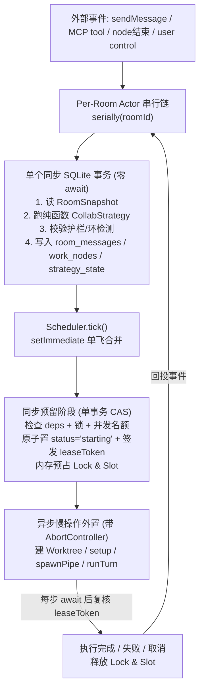
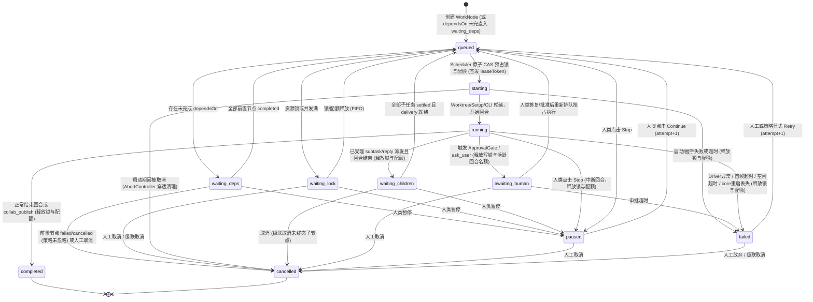

# MyAgents 架构设计评审结论与修订建议

> **文档说明**：本文件为独立评审报告，不修改原 `01`~`05` 号设计文档。  
> **评审基线**：[01-PRD-FEATURES.md](./01-PRD-FEATURES.md) · [02-ARCHITECTURE.md](./02-ARCHITECTURE.md) · [03-DOMAIN-DESIGN.md](./03-DOMAIN-DESIGN.md) · [04-API-PROTOCOL.md](./04-API-PROTOCOL.md) · [05-DATABASE-DESIGN.md](./05-DATABASE-DESIGN.md)  
> **复用参考源**：`G:\000TempAIRead\antumi-main\antumi-main`（Antumi，Apache 2.0 许可）

---

## 0. 评审总览与已确认方向

原方案的整体骨架很清晰：**`Room + Message + WorkNode + CollabStrategy` 统一内核**、**极薄 `daemon` 进程边界**、**SQLite 单一状态真相源**、**确定性优先路由**，这些核心决策都是成立的。

评审识别出的问题集中在四个根因：
1. **服务端无鉴权叠加终端/写文件能力**，构成直接 RCE 暴露面。
2. **任务调度缺少严谨的并发、锁、状态机与幂等边界**，存在死锁、数据竞争和双真相源。
3. **身份与会话模型不自洽**（同一 Agent 多立场、热会话增量投递、Reveal 可见性冲突）。
4. **MVP v0.1 一次性范围过宽**，但若合理复用 Antumi 源码（Apache 2.0），底座工作量可压缩 60% 以上。

已拍板的落地方向（本报告后续章节围绕这三点展开细化）：
- **安全基线**：采用极简方案——`admin / admin` 账号密码登录 + 最小防线，不搞复杂 RBAC。
- **任务调度**：作为重点专题彻底梳理竞态、死锁、边界情况与无竞态调度架构。
- **MVP 拆分与复用**：拆为 `v0.1a / v0.1b / v0.1c` 三阶段，深度复用 Antumi 经过实战验证的底层模块。

---

## 1. 原方案设计漏洞清单（P0 / P1 / P2）

### 1.1 P0：编码前必须解决

#### P0-1 服务端零鉴权 = 直接暴露 RCE 与 Prompt Injection 通道
- **位置**：[02-ARCHITECTURE.md L271-L291](./02-ARCHITECTURE.md)
- **漏洞**：v0.1 `AuthGuard` 为空实现，生产部署却监听 `0.0.0.0:3210`，同时开放了 Web PTY 终端、`files.write`、`workspaces.registerProject(任意路径)`、`workspace.exec`。任何能访问该端口的人都可直接获取服务器 Shell。
- **次生攻击链**：`/webhooks/generic/:hookId` 无验签 → 恶意构造内容进 Inbox → 命中自动路由规则 → 携带写权限/执行权限的 Agent 自动运行。
- **对策**：落地第 2 节的「最低安全基线（`admin/admin` 登录 + Webhook Secret + Inbox 默认降权）」。

#### P0-2 路径越界防护对 `exec` 与外部 CLI 实际无效，且缺少权限映射表
- **位置**：[02-ARCHITECTURE.md L247-L248](./02-ARCHITECTURE.md)、[03-DOMAIN-DESIGN.md L200](./03-DOMAIN-DESIGN.md)
- **漏洞**：`resolveContainedPath` 只拦截平台自有的文件 API；`workspace.exec`、Web PTY、外部 CLI（Claude / ACP）均可直接读写任意目录。同时，外部 CLI 如何强制落实 `read-only` 未定义——而调度器假设 `read-only` 委派不申请写锁、可立即并行，一旦 CLI 越权写盘就会与写节点踩踏。
- **对策**：
  1. 文档明确边界：v0.1 的路径校验仅防误操作，真正隔离需靠 OS 沙箱或容器。
  2. 补全 `permissionMode × workspaceMode` 到各 Driver CLI 参数的映射表（Claude 的 `--permission-mode` / `--allowedTools` / `--disallowedTools` / `--permission-prompt-tool`；ACP 的 `session/request_permission` 与 `fs/write_text_file` 拦截）。
  3. 明确 v0.1 跳过审批意味着外部 CLI 实际运行在自动放行模式（如 `bypassPermissions` / `acceptEdits`），并在配置界面提示风险。

#### P0-3 调度死锁：资源锁、并发名额与 `waiting_children` 语义未解耦
- **位置**：[03-DOMAIN-DESIGN.md §3.1 & §4.3](./03-DOMAIN-DESIGN.md)
- **漏洞**：以下三种正常业务场景都会直接死锁：
  1. 父节点以 `shared-rw` 持有 `workspace:/repo` 写锁 → `dispatch` 一个 `shared-rw` 子任务 → 子等父放锁、父等子结束。
  2. Agent A `maxConcurrency=1` → 父节点进 `waiting_children` 仍占着并发名额 → 子任务（或孙任务）路由回 A → 永久排队。
  3. A 用 `collab.reply` 追问 B，同时 B 也追问 A → 双方都进 `waiting_children`，互等对方名额。
- **对策**：见第 3 节规则 3——`waiting_children` / `paused` / `awaiting_human` 必须立刻释放资源写锁与活跃回合并发名额。

#### P0-4 无状态策略缺乏 Room 级串行化与状态写回动作
- **位置**：[03-DOMAIN-DESIGN.md §5](./03-DOMAIN-DESIGN.md)、[05-DATABASE-DESIGN.md L135](./05-DATABASE-DESIGN.md)
- **漏洞**：
  1. 两个 `round_post` 节点并发完成时，策略可能读到同一份旧快照：要么双方都看到“还有人在跑”导致整轮永久卡死，要么双方都看到“全员完成”导致重复 Reveal、重复开启下一轮。
  2. `rooms.strategy_state_json` 存在，但 `CollabStrategy` 返回的 `EngineAction` 未定义写回策略状态的动作，策略无法持久化 `round` 等状态。
- **对策**：见第 3 节规则 2——每个 Room 强制单线程串行事件循环（Per-Room Actor），在同步 SQLite 事务内一次性完成“读快照 → 算动作 → 写回 `strategy_state_json` 与新节点”；并在 04 文档补齐 `EngineAction` 完整联合类型。

#### P0-5 `agent_sessions` 按 `(room_id, agent_id)` 唯一，破坏同 Agent 多立场与并发执行
- **位置**：[05-DATABASE-DESIGN.md L156 & L248](./05-DATABASE-DESIGN.md)、[03-DOMAIN-DESIGN.md L52](./03-DOMAIN-DESIGN.md)
- **漏洞**：
  1. `room_members` 允许同一个 Agent 以不同立场加入同一 Room（如圆桌里的正方/反方），但 `agent_sessions` 约束 `UNIQUE(room_id, agent_id)`，导致正反两方共享同一个对话上下文，**第 1 轮盲答直接串台失效**。
  2. `room_messages.visible_to_json` 和 `work_nodes.assignee_id` 都用 `agentId`，同样无法区分同一 Agent 的不同成员席位。
  3. 即使同一席位，当 Agent `maxConcurrency >= 2` 且在同一 Room 并行跑两个节点时，外部 CLI 的单个原生进程/会话也无法并发执行两个回合。
- **对策**：
  - 将 `room_member_id` 提升为协作层一等身份：`agent_sessions`、`work_nodes.assignee_member_id`、消息 `visible_to_member_ids` 均按 `room_member_id` 索引（保留 `assignee_agent_id` 供并发统计）。
  - 规定**单条 `agent_session` 同一时刻只跑 1 个活跃回合**；同一席位确需并行时，派生临时子会话（`parent_session_id`）。

---

### 1.2 P1：设计阶段需补齐的关键缺口

#### P1-1 `core` 热重启接管缺少落地前提
- **位置**：[02-ARCHITECTURE.md §3.2](./02-ARCHITECTURE.md)、[04-API-PROTOCOL.md §4 & §6.1](./04-API-PROTOCOL.md)
- **问题**：
  1. `AgentDriver` 接口缺少 `reattach(session, replay)` 与 `capabilities`（是否支持 resume / steer / readOnly / MCP）。
  2. 内置 MCP 的 `sessionToken` 仅存内存，且放在 URL query 中：`core` 重启后 CLI 回调 MCP 会全部 401。
  3. 环形缓冲溢出无对账机制：daemon 未记录消费进度，断开期间输出超出缓冲会导致 stream-json 半行截断错位。
  4. ACP 是双向 JSON-RPC，CLI 可能正在等待 core 回复 `fs/read_text_file` 或 `session/request_permission`，重启后需处理悬空请求。
  5. `agent_sessions` 状态机中有 `detached`（[03 L153](./03-DOMAIN-DESIGN.md)），DDL 的 `CHECK` 约束中缺失（[05 L244](./05-DATABASE-DESIGN.md)）。
  6. Windows 上若从终端/IDE 拉起 daemon，父进程 Job Object 可能导致关终端时连带杀掉 daemon，需 `detached + windowsHide` 或系统服务托管。
- **对策**：直接复用 Antumi 的两套成熟机制——`ChatHost` + `ChatLog` + `LineFramer`（缓冲快照与实时流按 `offset` 排队合并）以及 `mcp-main.ts`（独立 stdio MCP 子进程，读 `core.json` 自动重连 core）。详见第 3、4 节。

#### P1-2 上下文投递未区分全量与增量，且 Reveal 会被增量游标漏读
- **位置**：[03-DOMAIN-DESIGN.md §4.2](./03-DOMAIN-DESIGN.md)、[05-DATABASE-DESIGN.md L242](./05-DATABASE-DESIGN.md)
- **问题**：
  1. 外部 CLI 自身维护原生会话历史，若每回合仍塞入 48k `ContextPacket`，会造成历史重复注入和 Token 浪费；表里设计了 `last_delivered_seq`，打包算法却未用到。
  2. **Reveal 漏读漏洞**：第 1 轮盲答消息的 `seq` 早于某些成员的 `last_delivered_seq`，公开（`private → public`）后按 `seq > last_delivered_seq` 拉增量会完全漏掉刚公开的发言。
  3. 按字符数（48,000 chars）做预算误差极大（中文 48k 字符≈48k+ Token，英文仅≈12k Token），且未把 MCP 工具 Schema 和 Skill Prompt 计入预算。
- **对策**：
  - 区分 **全量包**（builtin / cold / crashed / 无法 native resume）与 **增量包**（热 CLI 会话，只发增量消息）。
  - Reveal 时写入一条新 `seq` 的 `system` 汇总事件引用公开的消息，或记录每个会话已投递的消息集合，避免按 `seq` 漏读。
  - 预算改按估算 Token 分配，并保留工具与 Skill 的固定配额。

#### P1-3 `WorkNode` 状态机转移不完整、工具冲突与语义模糊
- **位置**：[03-DOMAIN-DESIGN.md §3.1](./03-DOMAIN-DESIGN.md)、[04-API-PROTOCOL.md §5.1](./04-API-PROTOCOL.md)
- **问题**：
  1. `failed` 是否属于唤醒父节点的“终态”未定义（状态图未画 `failed --> [*]`）。
  2. 缺失合法转换：`awaiting_human → cancelled / failed(timeout)`、`waiting_deps → paused / cancelled`、`waiting_lock → paused`、`failed → cancelled`。
  3. 同一回合同时调用 `collab.dispatch(subtask)` 与 `collab.publish` 时优先级未定；回合结束未调用 `publish` 时（尤其圆桌缺 `verdict`）无兜底。
  4. `transfer` 移交后原节点状态、Root 归属未定义；`reassign` 若原地改 `assignee_id` 会破坏审计链与 session 绑定。
  5. `TurnOutput.dispatchedSubtasks` 由 Driver 返回属于双真相源，应以 `CollabEngine` 实际受理的 dispatch 记录为准。
- **对策**：第 3 节给出修订后的完整状态机与工具冲突规则。

#### P1-4 `job_queue` 与 `work_nodes` 双重真相源与重试风暴
- **位置**：[05-DATABASE-DESIGN.md L193-L315](./05-DATABASE-DESIGN.md)
- **问题**：`work_nodes.status / attempt` 与 `job_queue.status / retry_count` 两套状态并行，叠加 LLM Client 的 `maxRetries`，最坏出现 `3 × 3 × 3` 重试风暴；`lane_key = 'room:<id>'` 若做串行锁，又会阻塞 `@everyone` 并行。DAG 依赖存 JSON 数组导致“查谁依赖我”只能全表扫描。
- **对策**：`work_nodes` 作为节点调度的唯一真相源；新增 `work_node_deps` 关系表；`job_queue` 仅承接同步/备份/定时等非节点任务（详见第 3 节）。

#### P1-5 协作群路由算法与工具交互的具体 Bug
- **位置**：[03-DOMAIN-DESIGN.md §4.1](./03-DOMAIN-DESIGN.md)、[04-API-PROTOCOL.md L190-L191](./04-API-PROTOCOL.md)
- **Bug 清单**：
  1. **中文正则失效**：规则 4 `/^(continue|resume|继续|接着做)\b/i` 中，JS 的 `\b` 仅识别 ASCII 单词字符，导致“继续”“接着做”**永远无法匹配**。应改为 `/^(?:continue|resume)\b|^(?:继续|接着做)(?:$|[\s，。！!,.])/i`，并尽量限制整句匹配避免误伤“继续优化这个函数”。
  2. **`idle` 强制改写误报高**：[03 L182](./03-DOMAIN-DESIGN.md)“正文提到成员名就覆盖 `idle` 为 `assign`”会在普通讨论（如“后端昨天改过这里”）时误触发派活，建议改为弱提示而非强派。
  3. **运行中节点的 follow-up**：规则 3 回复正在运行中的节点，对 ACP 等不支持回合中插话（steer）的外部 CLI 无法直接注入，需通过 Driver 能力位决定“steer 插话”还是“排队下一回合”。
  4. **LLM 拿不到 UUID**：`collab.dispatch` 参数要求 `recipientAgentId`（UUID），但上下文只展示名字；`collab.reply` 需要 `messageId`，必须确保在 `ContextPacket` 中显式渲染每条消息的短 ID，且工具侧接受成员名并由服务端解析。
  5. **`mode: 'parallel'` 未定义**：仅在 [04 L190](./04-API-PROTOCOL.md) 出现，01/03 均无定义，需删除或明确语义。

#### P1-6 MCP 工具名含点号不兼容主流模型与 CLI
- **位置**：[02-ARCHITECTURE.md L213](./02-ARCHITECTURE.md)、[04-API-PROTOCOL.md §5](./04-API-PROTOCOL.md)
- **问题**：`collab.dispatch`、`workspace.read` 带 `.` 不满足 OpenAI Function Calling 及部分 CLI 的 `^[a-zA-Z0-9_-]{1,64}$` 规范，且 02 与 04 文档混用了 `workspace_read` 和 `workspace.read`。
- **对策**：全链路统一为下划线命名（`collab_dispatch`、`workspace_read` 等，参考 Antumi `antumi_*` 风格）。

#### P1-7 圆桌策略（`roundtable`）逻辑漏洞
- **位置**：[03-DOMAIN-DESIGN.md §5.3](./03-DOMAIN-DESIGN.md)
- **漏洞**：
  1. `onHumanMessage` 固定重置 `round = 1`，与“第 2~N 轮读取人类插话”矛盾。需区分“新议题开题”与“讨论中途插话”（插话仅追加消息供下一轮消费）。
  2. 第 1 轮可见性写为 `[memberId, chairId]`：若 Chair 自身也参与第 1 轮作答，Chair 会在答复前偷看到先交卷成员的盲答。应规定 Chair 仅在 Reveal 后可见，或 Chair 不参与盲答。
  3. 匿名互评泄露面：工作区路径（含 `agentId`）、`[Request from teammate X]`、`author_name` 均需在匿名模式下统一脱敏为 `Member A/B/C`。
  4. 单成员失败时，需明确本轮收敛判定是“等待人工重试”还是“跳过失败席位继续”。

#### P1-8 `CollabStrategy` SPI 缺少关键钩子
- **位置**：[04-API-PROTOCOL.md §6.2](./04-API-PROTOCOL.md)
- **缺口**：仅有 `onHumanMessage / onNodeCompleted / onNodeFailed`，无法承接 `rooms.control`（`next_round / summarize_now / pause`）、节点被取消/暂停通知、成员变动、动态工具校验（如某些状态下禁止 `dispatch`）以及 `onIntake` / `onTimer`。
- **对策**：补充 `onControl`、`onNodeSettled`（统一处理 completed/failed/cancelled）、`onMembersChanged`、`validateToolCall`（可选钩子）。

#### P1-9 Worktree 完整生命周期不闭环
- **位置**：[01-PRD-FEATURES.md §3.2.1 & §5](./01-PRD-FEATURES.md)
- **缺口**：
  1. **跨节点共享 Worktree**：验收场景要求“Coder 改代码 → Reviewer 评审”，若 Coder 在独立 worktree 改完，Reviewer 如何挂载到同一个 worktree？`collab_dispatch` 需支持 `workspaceId` 或 `inheritWorkspaceFrom: nodeId`。
  2. **提交与合入责任未定义**：谁负责 `git commit`（Prompt 要求 Agent 提交 vs 平台兜底）、合回主分支是手动还是提供一键 Merge/PR 入口。
  3. **依赖初始化与磁盘膨胀**：新 worktree 无 `node_modules`，需项目级 setup 命令（且须人工信任确认，防恶意仓库执行任意脚本，Antumi 已有 `project-config-untrusted` 机制）以及空闲自动 GC。
  4. **Windows 长路径**：`~/.myagents/worktrees/<id>/<repo>/node_modules/...` 极易撞 260 字符上限，需缩短目录名（用 8 位 `shortId`）并检查 `core.longpaths`。

#### P1-10 外部 CLI 宿主配置隐式污染与热会话配置漂移
- **位置**：[02-ARCHITECTURE.md L220](./02-ARCHITECTURE.md)
- **问题**：
  1. 即使不改写 `~/.claude`，外部 CLI 运行时仍会读取宿主机用户目录的全局 settings、hooks、MCP 以及父目录 `CLAUDE.md`，行为不可控。
  2. 用户修改 Agent 的 `systemPrompt / model / skills` 后，已存活的外部 CLI 进程不会自动生效。
- **对策**：隔离配置目录（如 `CLAUDE_CONFIG_DIR` / `CODEX_HOME`，直接复用 Antumi `agent-accounts.ts`）；在 `agent_sessions` 上记录 `config_hash`，下回合启动前比对不一致则重建进程。

#### P1-11 数据库缺表、引用计数 Bug 与删除孤儿问题
- **位置**：[05-DATABASE-DESIGN.md §3 & §4](./05-DATABASE-DESIGN.md)
- **核心问题**：
  1. **附件 GC 逻辑死锁（永远删不掉）**：删除 Room/InboxItem 时未删除 `files` 表行，且引用散落在多张表的 `attachments_json` 中，后台清理器查 `files` 表永远看到引用存在。→ 应新增 `file_refs(file_id, owner_type, owner_id)` 统一引用计数，或直接复用 Antumi 的 `AttachmentSweeper` 扫描策略；同时 `storage_key` 不带扩展名，避免同内容不同后缀存两份。
  2. **缺少 4 张关键表**：
     - `node_events(node_id, attempt, seq, type, payload_json)`：持久化工具调用与阶段事件，否则刷新页面无法还原运行中回合的过程，v0.2 审计也无数据源。
     - `terminal_sessions`：领域模型有 `TerminalSession` 但缺表，core 重启后丢失终端与工作区的归属映射。
     - `webhooks`：`POST /webhooks/generic/:hookId` 的配置与 secret 无处存储。
     - `approval_requests`：`workNodes.respondApproval(requestId)` 无持久化表。
  3. **字段冗余与约束缺漏**：`rooms.state='archived'` 与 `archived_at` 重复；`agents.provider_id` 与 `driver_config_json.providerId` 重复；缺“每 Room 唯一活跃 lead”部分唯一索引；`work_nodes` 缺 `driver_snapshot_json`（记录当时实际模型用于成本核算）；`rooms` 级联物理删除会留下孤儿 daemon 进程和 worktree，应改为先停进程再软删的 Saga 流程。
  4. **Inbox 增量更新与完成联动**：`open-channel` 永远不会 `done`，导致 Inbox 无法自动 `resolved`；应关联 `root_node_id` 而非仅关联 `room_id`，并定义同一 `externalKey` 收到新评论时的追投规则。

#### P1-12 WebSocket 协议断线续传、队头阻塞与文件写冲突
- **位置**：[04-API-PROTOCOL.md §2 & §4](./04-API-PROTOCOL.md)
- **问题**：
  1. `room.streamDelta` 无递增序号，断线重连后容易乱序或重复；`rooms.subscribe` 应支持 `sinceSeq`；`rooms.sendMessage` 的 `idempotencyKey` 应设为必填。
  2. 终端 PTY 输出（高频大数据）与 JSON-RPC 控制帧共用一条 WS 会引发队头阻塞，建议终端走独立 WS 通道（支持二进制帧与背压）。
  3. `files.write` 缺少乐观锁（`expectedMtime`），Web 编辑器与 Agent 同时改同一文件会静默覆盖。
  4. Daemon 协议 `data: string` 需明确 `offset` 计量单位（Antumi 采用字符数且在 pipe 端用 utf8 流式解码器，避免多字节 UTF-8 截断乱码）。

---

### 1.3 P2：工程细节与演进建议

1. **权限合成公式显式化**：最终生效权限 = `min(agent.permissionMode, node.workspaceMode, strategy 约束, 来源信任等级)`，并明确定义 `full` 边界。
2. **补齐成本与洪泛护栏**：除按 Root 计次数外，增加单 Root/Room Token 预算、单 Root 总耗时上限、全局 LLM 并发上限及 Webhook 速率限制。
3. **单实例边界声明**：[02 L261](./02-ARCHITECTURE.md) 认为“换 PostgreSQL 即可多实例”过于乐观——内存锁（`RepoMutex`、`ResourceLockManager`）、Per-Room Actor、本地目录与本地 Daemon Socket 均为单机强假设，文档应诚实标注“v0.x 为单 Core 实例架构”。
4. **避免流式逐 Token 写 SQLite**：采用 `node:sqlite` 同步驱动时，流式 delta 在内存按帧/按秒聚合推送，仅在工具结束或回合结束时批量落库 `node_events`。
5. **`VACUUM INTO` 监控**：长时间读事务会阻滞 WAL checkpoint 导致 WAL 膨胀，备份需放低峰期，并注明 DB 与 Blob/工作区为最终一致快照而非原子一致性。
6. **附件落盘不污染代码仓**：附件解压/映射供外部 CLI 读取时，统一放 `~/.myagents/attachments/<roomId>/` 并通过 `--add-dir` / `readable` 授权，不写入用户 Git 仓库。
7. **错误码拆分**：`-32010` 拆分为 `unauthorized`（未登录）和 `forbidden`（无权限）。

---

### 1.4 原文档内部不一致汇总（后续修订时一并拉齐）

| 涉及位置 | 不一致内容 |
| :--- | :--- |
| [03 L153](./03-DOMAIN-DESIGN.md) vs [05 L243](./05-DATABASE-DESIGN.md) | `agent_sessions.status` 状态机含 `detached`，DDL `CHECK` 约束缺失 |
| [04 L190](./04-API-PROTOCOL.md) vs [01/03](./03-DOMAIN-DESIGN.md) | `collab.dispatch` 的 `mode: 'parallel'` 仅在 04 出现，01/03 无定义 |
| [02 L213](./02-ARCHITECTURE.md) vs [04 L197](./04-API-PROTOCOL.md) | 工作区工具混用 `workspace_read` 与 `workspace.read` |
| [03 L38](./03-DOMAIN-DESIGN.md) vs [05 L117](./05-DATABASE-DESIGN.md) | 并发默认值：文档写 builtin 默认 5，DDL 写死 `DEFAULT 2` |
| [02 L267](./02-ARCHITECTURE.md) vs [04 L278](./04-API-PROTOCOL.md) | `BackupAdapter.restore()` 在 02 出现，04 SPI 接口定义缺失 |
| [01 L117](./01-PRD-FEATURES.md) vs [05 L158](./05-DATABASE-DESIGN.md) | 群主字段名混用 `leadAgentId` 与 `room_members.role_kind = 'lead'` |
| [03 §3.2](./03-DOMAIN-DESIGN.md) | `single` Room 无暂停概念；讨论室从 `archived` 恢复应回到 `done` 而非 `active` |

---

## 2. 最低安全基线方案（极简可用版）

遵循「不复杂、开箱即用、`admin/admin` 可登录、兜住最低底线」的原则，总代码量约 **150~200 行**，直接挂在原设计的 `AuthGuard` Hook 上，后续平滑升级无返工。

### 2.1 账号登录与会话校验
- **默认凭据**：默认用户名 `admin`、密码 `admin`。
  - 支持环境变量覆盖：`MYAGENTS_ADMIN_USER`、`MYAGENTS_ADMIN_PASS`。
  - 密码校验后存哈希（`scryptSync` + 随机盐）到 SQLite 的 `auth_config` 表，支持在 Web 设置页一键修改密码。
  - 若检测到仍在使用默认 `admin/admin` 且监听地址不是 `127.0.0.1`，在启动日志和 Web 顶部挂一条温和提示条（不阻断使用）。
- **极简 REST 登录接口**：
  - `POST /api/auth/login`：校验用户名密码 → 生成 32 字节随机 `sessionToken`（存表 `auth_sessions`，默认 7 天滑动过期，重启 core 不掉登录态）→ 下发 `Set-Cookie: myagents_sid=<token>; HttpOnly; SameSite=Lax; Path=/`。
  - `POST /api/auth/logout`：删除会话并清 Cookie。
  - `GET /api/auth/me`：返回当前登录态 `{ authenticated, username }`。
  - `POST /api/auth/change-password`：改密并清理其他会话。
- **统一拦截（`SimplePasswordAuthGuard`）**：
  - 除 `/health`、`/api/auth/login`、`/api/auth/me`、`/webhooks/*` 和静态前端资源外，所有 `/api/*` 与 WebSocket `/rpc`（含终端 WS）强制校验 Cookie（同时兼容 `Authorization: Bearer <token>` 方便脚本调试）。
  - **WS 防跨站劫持（CSWSH）**：`ws` 握手 `verifyClient` 除了验 Cookie/Token，还需检查请求 `Origin` 与 `Host` 同源（或在显式白名单中），防止用户访问第三方网页时被恶意脚本悄悄连上本地 `ws://`。

### 2.2 外部 Webhook 与本机内部通道的最小防线
- **Webhook 简易验签**：每个通用 Webhook 自动生成一个随机 `secret`，请求需带 `X-Webhook-Secret` Header（或 GitHub `X-Hub-Signature-256` HMAC），无 secret 不入箱。
- **Inbox 默认降权**：来自外部 Webhook/插件自动路由触发的 `WorkNode`，默认最高权限为 `read-only`（禁止改文件、禁止 `exec`），只有在路由规则里人工显式勾选“允许写入/执行”才放开，用最小代价挡住 Prompt Injection。
- **本机内部边界（对用户完全无感）**：
  - Daemon Unix Socket 文件权限 `0600`（Windows Named Pipe 默认仅当前用户访问）。
  - 内置 MCP 复用 Antumi 模式：core 启动时在 `~/.myagents/run/core.json`（权限 `0600`）写入随机 `internalToken` 与本地监听端口，MCP stdio 子进程自行读取连接，不对外网暴露、也不把 Token 塞进 URL query。

---

## 3. 任务调度与并发竞态专题（核心重构建议）

任务调度是整个管理层最容易出隐蔽 Bug 的部分。结合原方案设计与 Antumi 实战演进中修过的真实故障（`CHANGELOG.md` 与 `SquadService / AgentProfileService / ChatHost` 源码），下面给出系统化的根因分析与无竞态架构。

### 3.1 必须消灭的 7 类经典竞态与边界坑

| 编号 | 故障场景 | 触发机理 | 后果 |
| :--- | :--- | :--- | :--- |
| **R1** | **锁/配额循环死锁** | 父节点在 `waiting_children` 仍占 `workspace` 写锁或 Agent `maxConcurrency`；或 A、B 互相 `collab_reply` | 父子互等、整个 Room 永久假死 |
| **R2** | **策略双推进 / 丢推进** | 两个并发子节点几乎同时完成，并发读取旧快照执行策略 | 重复 Reveal、重复开下一轮，或永远不进下一轮 |
| **R3** | **Check-Then-Act（TOCTOU）** | 检查配额通过 → `await` 建 Worktree / 启动 CLI → 期间配额被抢光，或用户点了 Cancel | 超并发上限、已取消的 Room 冒出孤儿进程 |
| **R4** | **重复交卷 / 重复唤醒** | 向父会话发送子结果后、尚未标 `delivered=true` 时 core 崩溃重启 | 重启后父 Agent 被重复唤醒多跑一轮（Antumi 真实踩坑） |
| **R5** | **慢 I/O 阻塞全局调度** | 把 `git worktree add`、`npm install`（setup）、CLI 握手塞进串行锁 | 一个慢仓库拉死全平台所有 Room |
| **R6** | **重启接管帧乱序与丢帧** | `core` 重启 `attach` 拉取历史缓冲的同时，daemon 推送实时 `data` | 同一段 JSON-RPC 被喂两次或半行截断，Driver 解析崩溃 |
| **R7** | **重试风暴与双真相源漂移** | `job_queue` 与 `work_nodes` 各自记状态和重试，叠加 LLM 层重试 | 3×3×3 放大失败调用；两张表状态不一致卡死 |

---

### 3.2 重构后的无竞态调度器架构（6 条铁律）

#### 铁律 1：单一真相源 + 独立依赖表
- **删除 `job_queue` 对 `WorkNode` 的镜像管理**。`work_nodes` 表本身就是持久化队列，配联合索引 `(status, created_at)`。`job_queue` 只留给 `sync_source` / `backup_snapshot` / `routine_tick` 等非节点后台任务。
- **新增关系表 `work_node_deps(node_id, depends_on_id)`**（带反向索引 `depends_on_id`），替代 `depends_on_json`。任何节点进入终态时，O(1) 找到所有依赖它的下游节点决定唤醒或级联取消。
- **重试分层唯一化**：网络 429/5xx 瞬时重试**只留在 LLM Client 内部**；`WorkNode` 级 `retry`（`attempt + 1`）只由人工或策略显式发起，禁止底层队列静默重跑有副作用的 Agent 回合。

#### 铁律 2：两级串行化 + 异步慢操作外置（彻底消灭 R2 / R3 / R5）
- **第一级：Per-Room Actor 串行链（`serially(roomId)`）**
  - 凡涉及修改某 Room 状态的操作（发消息、MCP 回调 `dispatch/publish/reply`、子节点终态通知、人工 `stop/cancel/retry/reassign`），全部排入该 Room 的 Promise 链顺序执行。
  - 利用 `node:sqlite` (`DatabaseSync`) 的同步特性，把「读快照 → 执行纯函数 `CollabStrategy` → 护栏校验 → 写入消息/节点/`strategy_state`」包进**单个同步事务（无任何 `await`）**，从根本上杜绝读旧快照和策略双推进。
- **第二级：全局轻量调度器（`Scheduler.tick()` 单飞 + 同步预留）**
  - 任何状态变更或锁释放只调用 `tick()`（用 `setImmediate` 合并同一事件循环内的多次触发，避免空转风暴）。
  - 调度器的“选人 + 抢锁 + 占名额”阶段完全**同步执行**：检查 `deps` 全完成 → 检查资源锁无冲突 → 检查全局并发与单 Agent 并发有余量 → **原子将节点改为 `starting`，生成新的 `lease_token`（UUID），并立刻在内存注册锁与配额占用**。
  - **慢操作全部移出串行链**：Worktree 创建、项目 `setup` 安装依赖、CLI 进程握手、LLM 流式回合，全部在锁外异步执行，并绑定一个 `AbortController` 登记在 `inFlight` Map 中。
  - **取消穿透与 CAS 复核**：用户点击 `Cancel`/`Stop` 时，立即置 DB 状态并触发 `abortController.abort()`；慢操作在每个 `await` 返回后、真正进入下一步前，必须复核 DB 中该节点仍满足 `status === 'starting' && lease_token === myToken`，若不匹配则立即释放刚创建的进程/资源并安静退出，彻底消灭孤儿进程。

#### 铁律 3：严格划分“持锁期”与“让出期”（根治 R1 死锁）
- **持锁与占活跃名额的状态**：仅限 **`starting`** 和 **`running`**。
- **必须立刻释放资源锁与活跃回合名额的状态**：
  - `waiting_children`（父等子时让出锁与名额，子任务才能在同一工作区或同一 Agent 上跑通）
  - `paused`（人工暂停）
  - `awaiting_human`（等待人工审批/回答）
  - `settled` 终态（`completed` / `failed` / `cancelled`）
- **分离两类配额与两类锁**：
  - **活跃推理配额 `maxRunningTurns`**（控制并发 LLM/计算，上述让出期立即释放）vs **存活进程上限 `maxLiveProcesses`**（控制宿主机内存，针对仍挂载在 daemon 里等待 `awaiting_human` 或空闲保活的外部 CLI 进程，超限时 LRU 休眠最老的空闲进程）。
  - **Git 仓库元数据锁（`RepoMutex`，按 `git --git-common-dir`）** vs **目录写锁（`ResourceLock`，按实际工作树路径含祖先/子目录包含判定）**——借鉴 Antumi `git-service.ts`，`worktree add/remove` 只短时锁仓库元数据，不影响其他分支 worktree 里的 Agent 并行编码。
- **防饥饿（Starvation）**：锁等待队列按节点的 `enqueued_at` 严格 FIFO 尝试，且当队首存在 `shared-rw` 写节点等待某目录锁时，禁止后续新到的同目录 `read-only` 或小任务插队。

#### 铁律 4：两阶段确定性结果投递（根治 R4 重复唤醒与漏投递）
借鉴 Antumi `SquadService` 的 `delivery` 批次持久化机制：
1. 引入 **`work_deliveries`** 表（或父节点上的 `pending_delivery_json`）：`{ id, roomId, targetNodeId, childNodeIds[], payloadText, status: 'pending' | 'sent' }`。
2. 当某父节点的全部（或策略定义的一批）子节点进入 **`settled`（`completed | failed | cancelled`）** 时，在 Room 事务内原子创建一条 `pending` 状态的 `delivery` 记录，固定好 `delivery.id` 与包含的 `childNodeIds`。
3. 投递唤醒父节点时，以 `delivery.id` 作为幂等键写入唤醒输入；确认父节点进入 `queued/starting` 后，再在同一事务中将 `delivery` 标为 `sent` 并更新对应子节点的 `delivered_at`。
4. 即使在第 2、3 步之间崩溃重启，对账流程看到 `pending` 的 `delivery`，用同一个 `delivery.id` 幂等重试，绝不重复建回合、绝不漏结果。
5. **迟到结果约定**：父节点已进入 `completed` 后，若用户对某个先前失败的子节点点 `retry` 并成功，不篡改已终结的父节点，而是由内核生成一条 `system_notice` 贴入 Room，由策略决定是否新开一个后续汇总回合。

#### 铁律 5：修订后的 `WorkNode` 完整状态机与边界约定

**明确 5 条边界规则**：
- **终态集合定义**：`settled = { completed, failed, cancelled }`；父节点唤醒检查 `allChildrenIn(settled)`。
- **工具调用冲突规则**：同一回合若已发出至少一个未结束的 `subtask`/`reply`，调用 `collab_publish` 返回校验错误（提示先等子任务返回或取消子任务）；若成功调用 `collab_publish`，忽略其后残余文本（折叠进过程日志）；若回合正常结束未调用 `collab_publish`，普通模式取最终文本，圆桌模式默认补 `verdict = 'changed'` 并记一条警告事件。
- **`transfer` 语义**：原节点立即进入 `completed`（附 `transferredToNodeId`），新节点继承同一 `requestMsgId` 但拥有独立分支（不阻塞原节点）。
- **`reassign` 语义**：不原地改 `assignee_id`，固定执行 `cancel(oldNode)` + `spawn(newNode, supersedesNodeId = oldNode.id)`，确保会话干净与审计可追溯。
- **首帧假死防线**：借鉴 Antumi `TurnWatch`，为外部 CLI 配置 `firstFrameTimeoutMs`（如 60s）与 `idleTimeoutMs`（如 300s），避免 CLI 吞掉请求永久挂在 `running`。

#### 铁律 6：启动对账（Reconcile）严格时序（根治 R6）
`core` 进程重启启动时，在对外开放 `rooms.sendMessage` 与启动 `Scheduler.tick()` 之前，必须按以下顺序完成对账（期间客户端连接可读列表但收到 `reconciling: true` 标志）：
1. 连接 `daemon`，调用 `daemon.list()` 获取当前所有存活/未释放进程。
2. 恢复 `terminal_sessions`（标记仍在 daemon 存活的终端，丢失的置 `exited`）。
3. 恢复存活的外部 CLI `agent_sessions`：对每个仍在 daemon 存活的会话调用 `ChatHost.open()`——先把 `attached = false`（期间新到的实时 `data` 暂存内存队列），调用 `daemon.attach(sessionId)` 拉回快照，按 `offset` 排序去重喂给 `LineFramer(lastConsumedOffset)`，补齐断联期间落盘事件，再置 `attached = true`。若检测到 `snapshot.bufferStart > lastConsumedOffset`（缓冲溢出缺口），显式标记当前节点 `failed(output_gap)`，不静默错位解析。
4. 对账所有 `status IN ('starting', 'running')` 的 `work_nodes`：
   - 外部 CLI 且已成功 reattach 且仍在回合中 → 重建内存锁与并发占用，继续监听完成。
   - 内置 `builtin` Agent 或进程已消失 → 标记 `failed(core_restarted)` 并通知策略/前端。
   - `starting` 状态（重启前卡在建 worktree/握手）→ 回退为 `queued` 或 `failed(core_restarted)` 并清理残留半成品。
5. 恢复所有 `pending` 状态的 `work_deliveries`。
6. 解除 `reconciling` 门禁，启动 `Scheduler.tick()`，对外放开写接口。

---

### 3.3 配套表结构补充建议（备忘，待后续修订 05 文档时采纳）
- **`agent_sessions`**：唯一键改为 `(room_id, room_member_id)`（支持临时并发派生 `parent_session_id`）；`status` 增加 `'detached'`；增加 `last_consumed_offset INTEGER NOT NULL DEFAULT 0`、`config_hash TEXT`。
- **`work_nodes`**：增加 `assignee_member_id TEXT`、`lease_token TEXT`、`supersedes_node_id TEXT`、`driver_snapshot_json TEXT`、`delivered_at INTEGER`；`status` 增加 `'starting'`。
- **新增 6 张小表**：
  1. `work_node_deps(node_id, depends_on_id)` — DAG 依赖与反向索引
  2. `work_deliveries(id, room_id, target_node_id, child_node_ids_json, payload_text, status, created_at)` — 两阶段结果投递
  3. `node_events(id, node_id, attempt, seq, kind, payload_json, created_at)` — 工具与过程事件持久化
  4. `terminal_sessions(id, workspace_id, daemon_session_id, status, created_at)` — Web 终端归属
  5. `auth_config / auth_sessions` — `admin/admin` 登录与会话
  6. `webhooks` & `file_refs(file_id, owner_type, owner_id)` & `approval_requests` — Webhook 配置、附件引用计数与审批预留

---

## 4. Antumi 源码与设计复用评估

已对 `G:\000TempAIRead\antumi-main\antumi-main` 完成代码盘点。

### 4.1 许可证与架构兼容性
- **许可证**：**Apache License 2.0**（商用/修改/分发友好；复用文件时按协议保留原作者版权声明和 LICENSE，并标注修改即可）。
- **天然契合服务端**：Antumi 的设计纪律明确规定 `core` 严禁引入任何 Electron 依赖，可直接无头运行在服务端；且 `core` 直接使用 **Node 22+ 原生 `node:sqlite` (`DatabaseSync`)**，**零 `better-sqlite3` C++ 编译依赖**，让原生模块真正只隔离在 `daemon`（仅 `node-pty`）——强烈建议 MyAgents 直接沿用 `node:sqlite`。

### 4.2 精确模块复用矩阵

| 类别 | Antumi 源码路径 | 代码量 | 复用方式 | 价值与适配说明 |
| :--- | :--- | :--- | :--- | :--- |
| **极薄进程宿主** | `packages/daemon/src/`（`session-host.ts`、`pipe-session.ts`、`pty-session.ts`、`output-buffer.ts`、`endpoint-claim.ts`、`session-ports.ts`） | ~800 行 | **几乎原样复制** | 极成熟：8MB pipe 缓冲 + 512KB PTY 缓冲、`ECONNREFUSED` 过期 socket 判定、`retire()` 平滑升级、子进程端口监听探测。剔除 `awake-service.ts` 即可。 |
| **跨平台进程启动** | `packages/protocol/src/node/`（`command-launch.ts`、`daemon-protocol.ts`、`paths.ts`、`private-file.ts`、`core-endpoint.ts`） | ~500 行 | **原样复制** | 解决 Windows `.cmd` 垫片直启、无 shell 防注入、Named Pipe / Unix Socket 路径与 `0600` 权限文件，且自带完善单元测试。 |
| **外部 CLI 驱动与热重启接管** | `packages/core/src/chat-host.ts` `packages/core/src/agents/`（`agent-adapter.ts`、`claude/claude-stream.ts`、`acp/acp-driver.ts` + 各 Dialect、`codex/`、`pi/`） | ~6000+ 行 | **核心复用 + 适配接口** | **最大红利区**。`ChatHost` 已实现 `ChatLog` + `LineFramer` + `attached` 缓冲排队回放 + `TurnWatch` 首帧超时检测；Claude / ACP(Gemini, Kimi, Cursor, OpenCode) / Codex / Pi 全协议实测且带录制 fixtures！只需在外层包一层 MyAgents 的 `AgentDriver` 适配器。 |
| **内置 MCP 抗重启桥** | `packages/core/src/mcp-main.ts`、`mcp-server.ts`、`mcp-servers.ts`、`user-mcp-launch.ts` | ~700 行 | **直接复用模式** | 独立 stdio MCP 子进程读 `core.json` 自动重连 core，天然抗热重启；换掉工具注册表即可暴露 MyAgents 的 `collab_*` 工具。 |
| **工作区 / Git / Worktree / 终端** | `packages/core/src/workspace.ts`、`worktree-service.ts`、`delegation-worktree.ts`、`git-service.ts`、`terminal-service.ts`、`file-search.ts`、`conversation-files.ts` | ~1800 行 | **直接复用微调** | 含 `repositoryKey` 与 `checkoutKey` 双粒度锁、安全清理 Worktree（检未提交/孤立 commit/忽略残留 `keptLeftovers`、永不删分支）、Web PTY 代理。 |
| **模型服务商 / 技能 / 环境 / 账号** | `packages/core/src/model-providers.ts`、`provider-request.ts`、`model-provider-probe.ts`、`skills-library.ts`、`environment-check.ts`、`agent-accounts.ts`、`attachment-sweep.ts` | ~1600 行 | **直接复用微调** | OpenAI Chat / Responses / Anthropic 协议探测与错误脱敏、多账号目录隔离（直接解 P1-10）、Skill 打包、CLI 探测。 |
| **插件 SDK 与外部接入（v0.1c / v0.2）** | `packages/plugin-sdk/`、`source-service.ts`、`plugin-service.ts`、`channel-service.ts` + `channel-{feishu,dingtalk,slack}.ts` | ~2500 行 | **二三期直接复用** | 现成的子进程插件框架与飞书/钉钉/Slack 渠道网关！ |
| **React Web UI 组件** | `packages/desktop/src/renderer/src/`（690 文件，基于 React 19 + Zustand + CodeMirror 6 + xterm.js 6 + react-markdown + mermaid） | 大量成熟组件 | **按需抽取复用** | 实测仅 90 行引用 `window.antumi`（64 行集中在 `desktop-bridge.ts`）！将 `desktop-bridge.ts` 替换为纯浏览器实现 + 登录页，即可复用聊天流渲染、Diff 面板、文件树+CodeMirror、xterm.js 终端。 |
| **多 Agent 编排（⚠️勿直接照搬）** | `squad-service.ts`、`discussion-service.ts`、`agent-profile-service.ts`、`conversation-service.ts` | ~4200 行 | **仅借鉴设计细节，不抄烟囱结构** | Antumi 把单聊委派、团队、讨论室写成了彼此独立的多套服务。应**坚持 MyAgents 的统一 `CollabEngine + Strategy` 内核**，只借鉴其中的 `serially`、`delivery` 批次持久化、`confirmCallClosed`、worktree setup 信任机制。 |
| **内置轻量 Agent（自研）** | （Antumi 仅有单轮小模型调用 `provider-request.ts`，无通用进程内 ReAct 循环） | — | **MyAgents 自研** | 在 `provider-request.ts` 基础上扩展流式 Tool-Calling + `maxSteps` ReAct 循环（约 500 行），这是 MyAgents 相比 Antumi 的核心差异化优势。 |
| **必须剥离的部分** | `desktop/src/main`（Electron）、`browser-service`（`WebContentsView`）、`mobile`（Noise 网关）、`pet-library`、`awake-service` | — | **彻底剔除** | 保持纯服务端 + Web 架构干净轻量。 |

---

## 5. 基于 Antumi 复用的 MVP 分期拆分路线图

把原方案庞大的 v0.1 拆成三个垂直闭环里程碑。每一期结束都是可部署、可日常使用的完整版本，且充分利用 Antumi 源码把第一期跑通时间压到最短。

### Phase 1（`v0.1a`）：底座打通 + 极简登录 + 双轨单聊 + Web 工作台
- **目标**：先跑通“能登录的纯服务端单 Agent 工作台”，验证双轨执行、热重启不中断与 Web 工作区体验。
- **直接复用 Antumi**：`daemon`、`protocol/node`、`node:sqlite`、`ChatHost` + Claude/ACP 驱动、`workspace/git/terminal-service`、`model-providers` + `environment-check`、`skills-library`、抽取 React 聊天/文件树/Diff/xterm.js 组件（替换 `desktop-bridge.ts`）。
- **本阶段自研**：
  1. 最低安全基线：`admin/admin` 登录页 + `SimplePasswordAuthGuard` + WS 鉴权与 `Origin` 校验。
  2. `BuiltinDriver`（进程内 ReAct + `workspace_*` 工具，支持 OpenAI-Compat / Anthropic）。
  3. `agent_private` 私有工作区自动创建。
  4. 最小化 `Room + WorkNode` 引擎（仅 `single` 策略 + 基础单机 Scheduler + `Reconcile` 启动对账）。
- **验收标准**：浏览器登录 `admin/admin` → 配 1 个内置轻量 Agent 与 1 个 Claude/ACP 外部 Agent → 单聊读写私有目录与项目目录、看 Diff、开 Web 终端 → 重启 `core`，已开终端和外部 CLI 会话无缝接管不中断。

### Phase 2（`v0.1b`）：无竞态调度器 + `@` 委派/Worktree + 开放协作群
- **目标**：攻克最核心的多 Agent 并发调度与协作群闭环，验证所有并发/锁/边界场景不死锁、不竞态。
- **本阶段重点**：
  1. 补全第 3 节全套无竞态调度机制：Per-Room Actor 同步事务、全局同步预留 + `lease_token` + `AbortController` 取消穿透、`work_node_deps` 表、资源锁与 `waiting_children` 让出规则、`work_deliveries` 两阶段结果投递、全套调度单元测试（死锁/并发/重启对账/取消穿透）。
  2. 复用 Antumi `mcp-main.ts` 桥接模式，上线内置 MCP 工具：`collab_dispatch / collab_reply / collab_publish / collab_history / collab_remember`（下划线命名），外部 CLI 与内置 Agent 共用同一套 Handler。
  3. 上线 `single` 下的 `@` 委派（含 `read-only` / `shared-rw` / `worktree` 三模式，复用 Antumi `delegation-worktree.ts` 与 `worktree-service.ts`）。
  4. 上线 `open-channel` 开放协作群（修正中文正则后的确定性路由 + 内置轻量 Lead 路由 + 护栏 + 右侧任务树实时干预 `Stop / Continue / Cancel / Retry / Reassign`）。
- **验收标准**：3 Agent 协作群（内置 Lead + 外部 Coder + 内置 Reviewer）在项目目录完成“Lead 路由 → Worktree 改代码 → Reviewer 同 Worktree 评审对齐 → Publish 汇总”，中途任意暂停/取消/重试及重启 `core` 均状态一致无孤儿进程。

### Phase 3（`v0.1c`）：统一收件箱 + 路由规则 + 圆桌讨论室
- **目标**：补齐外部信息接入与只读收敛讨论形态，完成原 PRD 定义的全部 v0.1 业务闭环。
- **本阶段重点**：
  1. 统一收件箱（`InboxItem`）：Web 手动入箱 + 通用 Webhook（带 `X-Webhook-Secret` 验签）+ 路由规则引擎（Inbox 来源默认只读降权）+ 复用 Antumi `plugin-sdk` 接入 GitHub Issues/PR 示范插件。
  2. `roundtable` 圆桌盲答讨论室：基于 `room_member_id` 会话隔离、修正插话与 Chair 盲答可见性规则、匿名脱敏、一键转交执行（`rooms.handoff`）。
  3. 附件引用计数 `file_refs` + Outbox 垃圾回收 + `node_events` 过程回放完善。
- **验收标准**：Webhook / GitHub 推入带附件事项进入 Inbox，可规则自动派发也可人工指派到协作群；3 立场圆桌完成“盲答 → Reveal 公开 → 多轮收敛 → 一键转交执行”闭环。

### Phase 4（`v0.2+`）：依托 Antumi 资产低成本扩张
完成前三期核心闭环后，以下能力可直接借力 Antumi 现成模块快速上线：
- 外部驱动扩展：直接启用 Antumi 的 `codex-app-server`、`pi-rpc`、`agent-accounts`（多账号额度切换）。
- 外部渠道扩展：复用 Antumi 的 `channel-service` + 飞书 / 钉钉 / Slack 网关（接入 `InboundEnvelope`）。
- 后台与治理：复用 `routine-service`（定时任务 + 静默机制）、升级 `ApprovalGate`（Web 审批卡片）、接 S3 `BlobStore` / 异步 `BackupAdapter`、按需升级多用户 RBAC。
